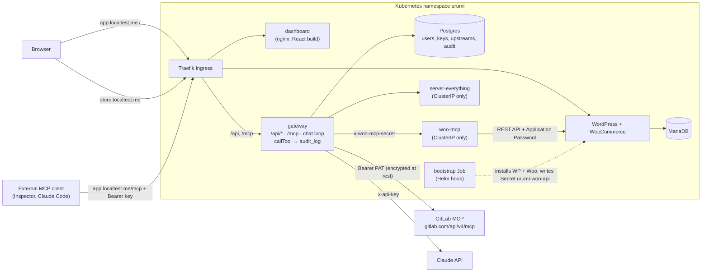

# Urumi MCP Gateway

A WooCommerce store and a team MCP gateway, both on Kubernetes. An admin registers MCP servers
once. Team members then use every enabled tool through one authenticated URL, from an MCP client
(Claude Code, Cursor, MCP Inspector) or from the dashboard's chat agent. Every tool call is
attributed to a user and audited. One Helm chart runs on local k3d and, with a different values
file, on a VPS.

Design: [`docs/DESIGN.md`](docs/DESIGN.md) · Threat model: [`docs/THREAT_MODEL.md`](docs/THREAT_MODEL.md)
· Requirement IDs (K1…D8): [`docs/REQUIREMENTS.md`](docs/REQUIREMENTS.md) · ADRs: [`docs/adr/`](docs/adr/)

## Architecture



| Component         | Source                            | Runs as                                   | Reachable from                                    |
| ----------------- | --------------------------------- | ----------------------------------------- | ------------------------------------------------- |
| gateway           | `apps/gateway`                    | Deployment `urumi-gateway`                | Ingress `app.<host>/api`, `/mcp`                  |
| dashboard         | `apps/dashboard`                  | Deployment `urumi-dashboard` (nginx)      | Ingress `app.<host>/`                             |
| woo-mcp           | `apps/woo-mcp`                    | Deployment `urumi-woo-mcp`                | gateway pods only (NetworkPolicy + shared secret) |
| server-everything | `apps/everything/Dockerfile`      | Deployment `urumi-everything`             | gateway pods only (NetworkPolicy)                 |
| WordPress + Woo   | official `wordpress` image        | Deployment + PVC                          | Ingress `store.<host>`                            |
| MariaDB           | official `mariadb` image          | StatefulSet + PVC                         | in-cluster                                        |
| Postgres 16       | official `postgres` image         | StatefulSet + PVC                         | gateway pods only (NetworkPolicy)                 |
| bootstrap         | `charts/platform/files/bootstrap` | Helm `post-install,post-upgrade` hook Job | —                                                 |
| GitLab MCP        | hosted by GitLab                  | external                                  | gateway, over the internet                        |

## Prerequisites

| Tool              | Version                        | Why                                     |
| ----------------- | ------------------------------ | --------------------------------------- |
| Docker            | Docker Desktop, **≥ 6 GB RAM** | k3d nodes and image builds              |
| k3d               | v5                             | local cluster (`scripts/cluster-up.sh`) |
| kubectl           | any recent                     | scripts pin the `k3d-urumi` context     |
| helm              | v3                             | the one chart                           |
| Node.js           | **≥ 22.13** (`.nvmrc`)         | workspaces, tests, e2e MCP client       |
| jq, curl, openssl | any                            | e2e scripts, `scripts/gen-env.sh`       |

`scripts/dev-setup.sh` installs them (Homebrew on macOS; apt + official installers on
Ubuntu/WSL2) and prints the versions it found. It does not pin versions. It also installs
`glab` and Claude Code, which you only need for the project's own agent workflow.

You also need:

- An **Anthropic API key** (chat: D2, D4).
- A **GitLab fine-grained personal access token** with the permission **"MCP tool: Execute"**
  (third upstream; see below). A classic PAT is refused by GitLab with
  `403 insufficient_granular_scope`.

## Zero to running

```sh
git clone <this repo> && cd urumi
npm install

# 1. Secrets file (gitignored, mode 600). Generates every *_PASSWORD, *_SECRET and
#    GATEWAY_ENC_KEY with openssl; refuses to overwrite an existing .env.local.
scripts/gen-env.sh

# 2. Fill in the two values a human must provide:
#      ANTHROPIC_API_KEY=sk-ant-...
#      GITLAB_MCP_TOKEN=glpat-...      (fine-grained, "MCP tool: Execute")
$EDITOR .env.local

# 3. Cluster: k3d `urumi` (1 server + 1 agent), registry localhost:5005, Traefik on 80/443,
#    namespace `urumi`, Secret `urumi-env` from .env.local. Safe to re-run.
scripts/cluster-up.sh

# 4. Build and push all images (gateway, dashboard, woo-mcp, everything) to the k3d registry.
scripts/build-images.sh

# 5. Install the chart. The bootstrap hook installs WordPress + WooCommerce and starts woo-mcp.
helm upgrade --install urumi charts/platform -n urumi -f charts/platform/values-local.yaml --wait

# 6. Run the eight demo flows.
tests/e2e/run.sh all
```

If you edit `.env.local` later (e.g. add a key), run `scripts/secrets-apply.sh` and
`kubectl -n urumi rollout restart deploy/urumi-gateway`.

**What the two hand-filled values gate**

| Missing             | Effect                                                                                                                                                                                                                                                                                                          |
| ------------------- | --------------------------------------------------------------------------------------------------------------------------------------------------------------------------------------------------------------------------------------------------------------------------------------------------------------- |
| `ANTHROPIC_API_KEY` | Gateway starts and logs `chat is disabled`. `POST /api/chat` answers **503** "Chat is not configured". **D2 and D4 fail**; the rest pass.                                                                                                                                                                       |
| `GITLAB_MCP_TOKEN`  | `tests/e2e/seed-upstreams.sh` stops with `GITLAB_MCP_TOKEN is empty`, so the **seed step fails and `run.sh all` reports every step D1–D8 as `FAIL Dn: seed failed`**. A token without the right scope registers, but the `gitlab` upstream stays `down` and the seed's "all three up" check fails the same way. |

The flows themselves only call `woo` and `everything` tools; GitLab is required because the
seed (and D3's tool listing) checks that all three upstreams are up. The gateway itself does not
need GitLab: register a different third server (ADR 002's fallback is DeepWiki,
`https://mcp.deepwiki.com/mcp`, no credential) from the dashboard if you only want to click
through.

**URLs** (`*.localtest.me` is public DNS that resolves to 127.0.0.1, no `/etc/hosts` edits):

| URL                                  | What                                                              |
| ------------------------------------ | ----------------------------------------------------------------- |
| `http://store.localtest.me`          | storefront                                                        |
| `http://store.localtest.me/wp-admin` | WooCommerce admin: `WP_ADMIN_USER` / `WP_ADMIN_PASSWORD`          |
| `http://app.localtest.me`            | dashboard: `SEED_ADMIN_EMAIL` / `SEED_ADMIN_PASSWORD`             |
| `http://app.localtest.me/mcp`        | MCP endpoint for external clients (`Authorization: Bearer urk_…`) |

Read the seed admin login from your own `.env.local` (`grep '^SEED_ADMIN_' .env.local`).

**Expected e2e output** — one `seed` line, then one line per flow; diagnostics go to
`tests/e2e/.out/<step>.log`. The exit code is non-zero if any step fails.

```
PASS seed
PASS D1
PASS D2
PASS D3
PASS D4
PASS D5
PASS D6
PASS D7
PASS D8
```

Single steps: `tests/e2e/run.sh D3 D5` (seeds first if there is no current run).

**Timing (approximate, not a benchmark):** a fresh install from nothing — cluster, four image
builds, chart install with the WooCommerce download — takes on the order of 10 minutes on a
laptop, most of it image builds and the bootstrap Job. `run.sh all` takes a few minutes; D7 alone
waits for one health cycle down (≤ 25 s) and back up (≤ 60 s).

## Demo walkthrough (manual D1–D8)

`tests/e2e/run.sh all` creates two members, `usera@urumi.test` (User A) and `userb@urumi.test`
(User B); their temporary passwords are kept in `tests/e2e/.out/users.json`. To click through by
hand, create them yourself under **Members** (admin), which shows each temporary password once.

1. **D1 — store checkout.** Open `http://store.localtest.me`, add _Demo Tee_ to the cart, check
   out with **Cash on delivery**. In `wp-admin` → WooCommerce → Orders, the order is there.
2. **D2 — User A chat.** Sign in to the dashboard as User A → **Chat**: "Create a product called
   Urumi Mug priced 499". The reply lists `woo__create_product` under **Tools used**. Place an
   order for it on the storefront, then ask "What orders came in today?". "Today" is the
   Asia/Kolkata calendar day by `date_created`.
3. **D3 — User B external client.** As User B → **My keys** → create a key and copy it (shown
   once). The page also shows an **MCP client configuration** snippet. Then:
   ```sh
   npx @modelcontextprotocol/inspector
   ```
   Transport **Streamable HTTP**, URL `http://app.localtest.me/mcp`, header
   `Authorization: Bearer urk_…` → **List Tools** shows `woo__*`, `everything__*`, `gitlab__*` →
   call `woo__list_orders` with `{"date":"today"}`.
4. **D4 — two servers in one prompt.** As User A in Chat: "Call everything's echo tool with
   message 'urumi' and list today's store orders." **Tools used** shows an `everything__echo` and
   a `woo__list_orders` call. A woo + gitlab prompt ("summarise today's orders and open a GitLab
   issue with the summary", the D4 story in `docs/PLAN.md` §8 Q4) uses the same path but writes to GitLab, so
   the scripted D4 uses `everything` instead.
5. **D5 — revoke.** Admin → **Members** → User B → keys → revoke (or User B revokes it under
   **My keys**). In the Inspector, **List Tools** again → 401.
6. **D6 — disable a server.** Admin → **Upstreams** → **Disable** `everything`. Its tools vanish
   from **Tools**, from the chat tool set, and from the Inspector's next **List Tools** (the
   endpoint is stateless, so there is no push; re-list). **Enable** restores them.
7. **D7 — kill an upstream.**
   `kubectl -n urumi scale deploy/urumi-everything --replicas=0` (or delete its pod). Within one
   health cycle (15 s + 3 s) **Upstreams** shows `everything` **down** with its last error; `woo`
   tools keep working in chat and in the Inspector. Scale back to 1 and it returns to **up**.
8. **D8 — audit.** Admin → **Audit**: every call above, with user, source (`chat`/`mcp`), server,
   tool, time, duration, outcome. Members see only their own rows.

## Local → VPS

The same chart and templates; only the values file and the out-of-band Secrets change.
`charts/platform/values-prod.yaml` differs from `values-local.yaml` in:

| Setting                      | Local                                               | Prod (`values-prod.yaml`)                                            |
| ---------------------------- | --------------------------------------------------- | -------------------------------------------------------------------- |
| `store.host`, `app.host`     | `store.localtest.me`, `app.localtest.me`            | placeholders `store.example.com`, `app.example.com`                  |
| `store.tls`, `app.tls`       | off                                                 | off until a certificate Secret (`store-tls`, `app-tls`) exists       |
| `gateway.publicOrigin`       | `http://app.localtest.me`                           | `https://app.example.com`                                            |
| `gateway.cookieSecure`       | `false`                                             | `true`                                                               |
| `bootstrap.environmentType`  | `local` (App Passwords over HTTP)                   | `production` (HTTPS required)                                        |
| `wooMcp.forwardedProto`      | empty                                               | `https` (in-cluster HTTP calls claim HTTPS to WordPress)             |
| `*.persistence.storageClass` | `local-path`, 1–2 Gi                                | cluster default, 5 Gi                                                |
| `*.image.repository` / `tag` | `k3d-urumi-registry.localhost:5005/…:dev`, `Always` | `registry.gitlab.com/<group>/<project>/…`, tag empty, `IfNotPresent` |

Resource requests/limits are the same in both (set in `values.yaml`).

Steps on a single-node k3s VPS (Traefik is k3s's default ingress, matching `ingress.className`):

1. DNS: `A` records for both hosts → the VPS IP.
2. Images: push the four images to a registry the VPS can pull from; set every
   `*.image.repository` and `tag` in a copy of `values-prod.yaml`, plus the hosts and
   `gateway.publicOrigin`.
3. Secrets, created out-of-band (the chart never renders a Secret; `tests/infra/chart-checks.sh`
   enforces this): `kubectl -n urumi create secret generic urumi-env --from-env-file=<file>` with
   the same keys as `.env.local`, generated on the server, never committed.
4. TLS: either install cert-manager with a Let's Encrypt `ClusterIssuer` and a `Certificate` per
   host writing `store-tls` / `app-tls`, or configure Traefik's ACME resolver (k3s
   `HelmChartConfig`). Then set `store.tls.enabled` / `app.tls.enabled: true`. Neither cert-manager
   nor ACME is part of this chart.
5. `helm upgrade --install urumi charts/platform -n urumi -f values-prod.yaml --wait`, then
   register the three upstreams in the dashboard (**Upstreams**). `tests/e2e/seed-upstreams.sh`
   is written for the local cluster: it reads the Secret through the pinned `k3d-urumi` kubectl
   context.
6. Egress: the bootstrap Job downloads WooCommerce from wordpress.org; the gateway needs
   `gitlab.com:443` and `api.anthropic.com:443`. No egress NetworkPolicy exists today.

**Honest status.** The VPS deployment is optional (issue #25, first in the cut order) and has
**not** been run. What is tested: `tests/infra/chart-checks.sh` renders the chart with both
`values-local.yaml` and `values-prod.yaml` and checks every container has probes and
requests/limits and that no Secret is rendered. Not tested: TLS, cert-manager/ACME, a real
StorageClass, pulling from a remote registry, `environmentType: production` with
`X-Forwarded-Proto`, and there is no CI job that builds or pushes images (#22).

## Troubleshooting

| Symptom                                                      | Cause and fix                                                                                                                                                                                                                                                       |
| ------------------------------------------------------------ | ------------------------------------------------------------------------------------------------------------------------------------------------------------------------------------------------------------------------------------------------------------------- |
| `cluster-up.sh`: `port 80 is in use`                         | Another server holds 80/443. `HTTP_PORT=8080 HTTPS_PORT=8443 scripts/cluster-up.sh`, then use `http://app.localtest.me:8080`. Ports are fixed at creation: `scripts/cluster-down.sh --yes` first. The e2e scripts assume port 80.                                   |
| Pods `Pending`/`OOMKilled`, `helm --wait` times out          | Docker Desktop has too little memory. Give it ≥ 6 GB (Settings → Resources), restart, re-run `helm upgrade --install`.                                                                                                                                              |
| `urumi-woo-mcp` shows `0/0` after install                    | Expected for a moment: the chart renders woo-mcp with 0 replicas until the bootstrap Job has written Secret `urumi-woo-api`, then the Job scales it to 1. If it stays at 0: `kubectl -n urumi logs job/urumi-bootstrap --all-containers` (the Job is kept for 1 h). |
| Bootstrap fails the `GET /wp-json/wc/v3/orders` check (401)  | WordPress accepts Application Passwords only over HTTPS unless `WP_ENVIRONMENT_TYPE=local`. Locally keep `bootstrap.environmentType: local`; in prod serve HTTPS and keep `wooMcp.forwardedProto: https`.                                                           |
| `gitlab` upstream `down`, `lastError` `HTTP 403`; seed fails | `GITLAB_MCP_TOKEN` is a classic PAT or lacks "MCP tool: Execute", or has expired. Create a fine-grained PAT, put it in `.env.local`, `scripts/secrets-apply.sh`, then `tests/e2e/seed-upstreams.sh` (re-sends the credential).                                      |
| Chat says "Chat is not configured" (HTTP 503)                | `ANTHROPIC_API_KEY` is empty in Secret `urumi-env`. Fill it in, `scripts/secrets-apply.sh`, `kubectl -n urumi rollout restart deploy/urumi-gateway`.                                                                                                                |
| Chat says "The chat model is unavailable, try again"         | Anthropic returned an error (bad key, no credit, model id). The gateway logs only the error class and HTTP status: `kubectl -n urumi logs deploy/urumi-gateway \| grep anthropic`.                                                                                  |
| A rebuilt image does not show up                             | Tags are `:dev` with `pullPolicy: Always`: `kubectl -n urumi rollout restart deploy/urumi-<component>`.                                                                                                                                                             |
| Start over                                                   | `helm uninstall` keeps PVCs, the bootstrap Job and Secret `urumi-woo-api`. Delete the Job before the PVCs (its pod holds the WordPress PVC), or simply `scripts/cluster-down.sh --yes` (`--all` also removes the registry).                                         |

## Repo layout

```
apps/woo-mcp/        WooCommerce MCP server (TypeScript, Streamable HTTP, internal-only)
apps/gateway/        MCP gateway + admin API + chat agent backend (Fastify, Postgres)
apps/dashboard/      React + Vite admin/member UI and chat panel (served by nginx)
apps/everything/     Dockerfile for @modelcontextprotocol/server-everything (upstream 2)
packages/contracts/  Shared zod schemas: API, DB schema (sql/), tool naming, error envelope
charts/platform/     The one Helm chart; values.yaml, values-local.yaml, values-prod.yaml
tests/e2e/           D1–D8 scripted flows (run.sh <step|all>), seed scripts
tests/infra/         Cluster checks: chart, persistence, bootstrap, NetworkPolicies, auth
scripts/             dev-setup, gen-env, cluster-up/down, secrets-apply, build-images
docs/                REQUIREMENTS, PLAN, DESIGN, THREAT_MODEL, adr/
```

## Tests

```sh
npm test               # unit + contract tests in every workspace (vitest)
npm run lint           # eslint + prettier --check
npm run typecheck      # tsc --noEmit in every workspace
```

- Gateway tests run against a real Postgres: a throwaway Docker container locally, or
  `TEST_DATABASE_URL` (CI uses a `postgres:16-alpine` service). Upstreams are fake MCP servers
  (`apps/gateway/test/helpers/fake-upstream.ts`); only external boundaries are faked.
- Cluster checks (need the local cluster): `tests/infra/chart-checks.sh` (offline),
  `persistence.sh`, `store-bootstrap.sh`, `gateway-db.sh`, `gateway-auth.sh`, `upstreams.sh`,
  `woo-mcp-netpol.sh`, plus `scripts/smoke-ingress.sh`.
- End to end: `tests/e2e/run.sh all`.

**CI** (`.gitlab-ci.yml`): `lint` (lint + typecheck), `test` (all workspaces with a Postgres
service), and GitLab's `secret_detection`, `semgrep-sast` and `kics-iac-sast` templates in a
`secure` stage. CI does not build images, run the infra checks or run the e2e flows; those run
against a local cluster.

## License

[MIT](LICENSE)
