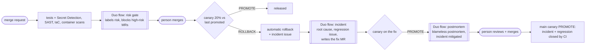
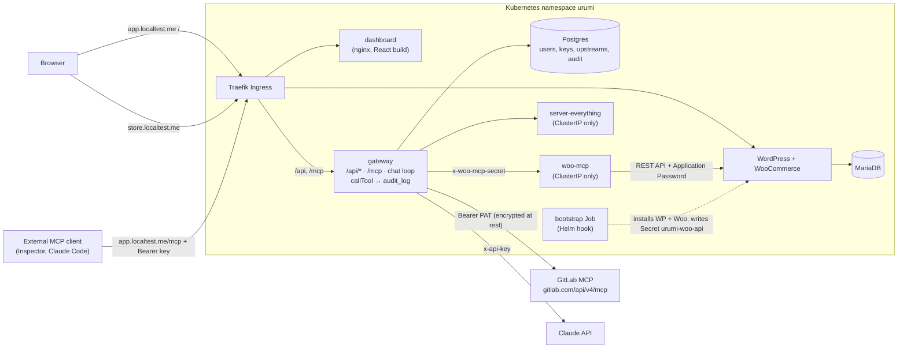

# Urumi MCP Gateway

A WooCommerce store and a team MCP gateway, both on Kubernetes. An admin registers MCP servers
once. Team members then use every enabled tool through one authenticated URL, from an MCP client
(Claude Code, Cursor, MCP Inspector) or from the dashboard's chat agent. Every tool call is
attributed to a user and audited. One Helm chart runs on local k3d and, with a different values
file, on a VPS.

**New here? Start with [`docs/RUN_ON_YOUR_COMPUTER.md`](docs/RUN_ON_YOUR_COMPUTER.md)** — a
plain-language, step-by-step guide to running it on your own laptop.

Design: [`docs/DESIGN.md`](docs/DESIGN.md) · Threat model: [`docs/THREAT_MODEL.md`](docs/THREAT_MODEL.md)
· Requirement IDs (K1…D8): [`docs/REQUIREMENTS.md`](docs/REQUIREMENTS.md) · ADRs: [`docs/adr/`](docs/adr/)

## GitLab Transcend hackathon: a release pipeline that heals itself

**Problem.** Teams automate shipping, but a bad release is still handled by hand: someone notices,
rolls back, digs through commits, writes a fix, checks it and writes the postmortem. That is hours
of on-call work, and a regression that keeps HTTP 200s (wrong results, not errors) is often missed.

**What this project does.** Everything after the code is written runs as agents on GitLab CI and
the **GitLab Duo Agent Platform** (three custom flows in [`.gitlab/flows/`](.gitlab/flows/)):



**Autonomy level: Supervised.** Agents run every step on their own: scanning, risk
classification, canary verdict, rollback, investigation, the fix, its verification and the
postmortem. A person approves only the outcome: the merge. Agents have no merge or approve tool,
and high-risk changes (auth, keys, CI, charts, secrets) wait for a human.

**It ran for real** (all of it is in this project's history):

| Step                                                                                   | Evidence                                                                                                                                                                                                       |
| -------------------------------------------------------------------------------------- | -------------------------------------------------------------------------------------------------------------------------------------------------------------------------------------------------------------- |
| A "perf" change caps tool results at 4 KB and breaks `woo__list_orders`                | [!33](https://gitlab.com/gitlab-ai-hackathon/transcend-october-2026/36848717/showcase/-/merge_requests/33)                                                                                                     |
| The canary sees tool success fall to 0 % while HTTP errors stay at 0 %, and rolls back | [pipelines](https://gitlab.com/gitlab-ai-hackathon/transcend-october-2026/36848717/showcase/-/pipelines)                                                                                                       |
| CI opens the incident; Duo triages it and opens the regression issue                   | [#30](https://gitlab.com/gitlab-ai-hackathon/transcend-october-2026/36848717/showcase/-/work_items/30), [#31](https://gitlab.com/gitlab-ai-hackathon/transcend-october-2026/36848717/showcase/-/work_items/31) |
| Duo writes the fix MR; its canary returns PROMOTE                                      | [!34](https://gitlab.com/gitlab-ai-hackathon/transcend-october-2026/36848717/showcase/-/merge_requests/34)                                                                                                     |
| Duo verifies the verdict and posts the blameless postmortem                            | [#30](https://gitlab.com/gitlab-ai-hackathon/transcend-october-2026/36848717/showcase/-/work_items/30)                                                                                                         |
| A person merges; main's canary PROMOTEs; the incident is closed                        | [#30](https://gitlab.com/gitlab-ai-hackathon/transcend-october-2026/36848717/showcase/-/work_items/30)                                                                                                         |

Details: [`docs/HACKATHON.md`](docs/HACKATHON.md) · ADRs [003 canary](docs/adr/003-canary.md),
[004 Duo flows](docs/adr/004-duo-flows.md), [005 self-healing](docs/adr/005-self-healing.md),
[007 Duo dispatch](docs/adr/007-duo-dispatch.md).

## The application being released

## Architecture



| Component         | Source                            | Runs as                                   | Reachable from                                    |
| ----------------- | --------------------------------- | ----------------------------------------- | ------------------------------------------------- |
| gateway           | `apps/gateway`                    | Deployment `urumi-gateway`                | Ingress `app.<host>/api`, `/mcp`                  |
| dashboard         | `apps/dashboard`                  | Deployment `urumi-dashboard` (nginx)      | Ingress `app.<host>/`                             |
| woo-mcp           | `apps/woo-mcp`                    | Deployment `urumi-woo-mcp`                | gateway pods only (NetworkPolicy + shared secret) |
| server-everything | `apps/everything/Dockerfile`      | Deployment `urumi-everything`             | gateway pods only (NetworkPolicy)                 |
| WordPress + Woo   | official `wordpress` image        | Deployment + PVC                          | Ingress `store.<host>`                            |
| MariaDB           | official `mariadb` image          | StatefulSet + PVC                         | in-cluster                                        |
| Postgres 16       | official `postgres` image         | StatefulSet + PVC                         | gateway pods only (NetworkPolicy)                 |
| bootstrap         | `charts/platform/files/bootstrap` | Helm `post-install,post-upgrade` hook Job | —                                                 |
| GitLab MCP        | hosted by GitLab                  | external                                  | gateway, over the internet                        |

## Prerequisites

| Tool              | Version                        | Why                                     |
| ----------------- | ------------------------------ | --------------------------------------- |
| Docker            | Docker Desktop, **≥ 6 GB RAM** | k3d nodes and image builds              |
| k3d               | v5                             | local cluster (`scripts/cluster-up.sh`) |
| kubectl           | any recent                     | scripts pin the `k3d-urumi` context     |
| helm              | v3                             | the one chart                           |
| Node.js           | **≥ 22.13** (`.nvmrc`)         | workspaces, tests, e2e MCP client       |
| jq, curl, openssl | any                            | e2e scripts, `scripts/gen-env.sh`       |

`scripts/dev-setup.sh` installs them (Homebrew on macOS; apt + official installers on
Ubuntu/WSL2) and prints the versions it found. It does not pin versions. It also installs
`glab` and Claude Code, which you only need for the project's own agent workflow.

You also need:

- An **Anthropic API key** (chat: D2, D4).
- A **GitLab fine-grained personal access token** with the permission **"MCP tool: Execute"**
  (third upstream; see below). A classic PAT is refused by GitLab with
  `403 insufficient_granular_scope`.

## Zero to running

```sh
git clone https://gitlab.com/gitlab-ai-hackathon/transcend-october-2026/36848717/showcase.git urumi && cd urumi
npm install

# 1. Secrets file (gitignored, mode 600). Generates every *_PASSWORD, *_SECRET and
#    GATEWAY_ENC_KEY with openssl; refuses to overwrite an existing .env.local.
scripts/gen-env.sh

# 2. Fill in the two values a human must provide:
#      ANTHROPIC_API_KEY=sk-ant-...
#      GITLAB_MCP_TOKEN=glpat-...      (fine-grained, "MCP tool: Execute")
$EDITOR .env.local

# 3. Cluster: k3d `urumi` (1 server + 1 agent), registry localhost:5005, Traefik on 80/443,
#    namespace `urumi`, Secret `urumi-env` from .env.local. Safe to re-run.
scripts/cluster-up.sh

# 4. Build and push all images (gateway, dashboard, woo-mcp, everything) to the k3d registry.
scripts/build-images.sh

# 5. Install the chart. The bootstrap hook installs WordPress + WooCommerce and starts woo-mcp.
helm upgrade --install urumi charts/platform -n urumi -f charts/platform/values-local.yaml --wait

# 6. Run the demo flows (D1–D8 from the brief, plus D9–D15: permissions, scaling,
#    observability, discovery mode, OAuth, hosted MCP servers, multiple stores).
tests/e2e/run.sh all
```

If you edit `.env.local` later (e.g. add a key), run `scripts/secrets-apply.sh` and
`kubectl -n urumi rollout restart deploy/urumi-gateway`.

**What the two hand-filled values gate**

| Missing             | Effect                                                                                                                                                                                                                                                                                                          |
| ------------------- | --------------------------------------------------------------------------------------------------------------------------------------------------------------------------------------------------------------------------------------------------------------------------------------------------------------- |
| `ANTHROPIC_API_KEY` | Gateway starts and logs `chat is disabled`. `POST /api/chat` answers **503** "Chat is not configured". **D2 and D4 fail**; the rest pass.                                                                                                                                                                       |
| `GITLAB_MCP_TOKEN`  | `tests/e2e/seed-upstreams.sh` stops with `GITLAB_MCP_TOKEN is empty`, so the **seed step fails and `run.sh all` reports every step D1–D8 as `FAIL Dn: seed failed`**. A token without the right scope registers, but the `gitlab` upstream stays `down` and the seed's "all three up" check fails the same way. |

The flows themselves only call `woo` and `everything` tools; GitLab is required because the
seed (and D3's tool listing) checks that all three upstreams are up. The gateway itself does not
need GitLab: register a different third server (ADR 002's fallback is DeepWiki,
`https://mcp.deepwiki.com/mcp`, no credential) from the dashboard if you only want to click
through.

**URLs** (`*.localtest.me` is public DNS that resolves to 127.0.0.1, no `/etc/hosts` edits):

| URL                                  | What                                                              |
| ------------------------------------ | ----------------------------------------------------------------- |
| `http://store.localtest.me`          | storefront                                                        |
| `http://store.localtest.me/wp-admin` | WooCommerce admin: `WP_ADMIN_USER` / `WP_ADMIN_PASSWORD`          |
| `http://app.localtest.me`            | dashboard: `SEED_ADMIN_EMAIL` / `SEED_ADMIN_PASSWORD`             |
| `http://app.localtest.me/mcp`        | MCP endpoint for external clients (`Authorization: Bearer urk_…`) |

Read the seed admin login from your own `.env.local` (`grep '^SEED_ADMIN_' .env.local`).

**Expected e2e output** — one `seed` line, then one line per flow; diagnostics go to
`tests/e2e/.out/<step>.log`. The exit code is non-zero if any step fails.

```
PASS seed
PASS D1
PASS D2
PASS D3
PASS D4
PASS D5
PASS D6
PASS D7
PASS D8
PASS D9
```

Single steps: `tests/e2e/run.sh D3 D5` (seeds first if there is no current run).

**Timing (approximate, not a benchmark):** a fresh install from nothing — cluster, four image
builds, chart install with the WooCommerce download — takes on the order of 10 minutes on a
laptop, most of it image builds and the bootstrap Job. `run.sh all` takes a few minutes; D7 alone
waits for one health cycle down (≤ 25 s) and back up (≤ 60 s).

## Demo walkthrough (manual D1–D9)

`tests/e2e/run.sh all` creates two members, `usera@urumi.test` (User A) and `userb@urumi.test`
(User B); their temporary passwords are kept in `tests/e2e/.out/users.json`. To click through by
hand, create them yourself under **Members** (admin), which shows each temporary password once.

1. **D1 — store checkout.** Open `http://store.localtest.me`, add _Demo Tee_ to the cart, check
   out with **Cash on delivery**. In `wp-admin` → WooCommerce → Orders, the order is there.
2. **D2 — User A chat.** Sign in to the dashboard as User A → **Chat**: "Create a product called
   Urumi Mug priced 499". The reply lists `woo__create_product` under **Tools used**. Place an
   order for it on the storefront, then ask "What orders came in today?". "Today" is the
   Asia/Kolkata calendar day by `date_created`.
3. **D3 — User B external client.** As User B → **My keys** → create a key and copy it (shown
   once). The page also shows an **MCP client configuration** snippet. Then:
   ```sh
   npx @modelcontextprotocol/inspector
   ```
   Transport **Streamable HTTP**, URL `http://app.localtest.me/mcp`, header
   `Authorization: Bearer urk_…` → **List Tools** shows `woo__*`, `everything__*`, `gitlab__*` →
   call `woo__list_orders` with `{"date":"today"}`.
4. **D4 — two servers in one prompt.** As User A in Chat: "Call everything's echo tool with
   message 'urumi' and list today's store orders." **Tools used** shows an `everything__echo` and
   a `woo__list_orders` call. A woo + gitlab prompt ("summarise today's orders and open a GitLab
   issue with the summary", the D4 story in `docs/PLAN.md` §8 Q4) uses the same path but writes to GitLab, so
   the scripted D4 uses `everything` instead.
5. **D5 — revoke.** Admin → **Members** → User B → keys → revoke (or User B revokes it under
   **My keys**). In the Inspector, **List Tools** again → 401.
6. **D6 — disable a server.** Admin → **Upstreams** → **Disable** `everything`. Its tools vanish
   from **Tools**, from the chat tool set, and from the Inspector's next **List Tools** (the
   endpoint is stateless, so there is no push; re-list). **Enable** restores them.
7. **D7 — kill an upstream.**
   `kubectl -n urumi scale deploy/urumi-everything --replicas=0` (or delete its pod). Within one
   health cycle (15 s + 3 s) **Upstreams** shows `everything` **down** with its last error; `woo`
   tools keep working in chat and in the Inspector. Scale back to 1 and it returns to **up**.
8. **D8 — audit.** Admin → **Audit**: every call above, with user, source (`chat`/`mcp`), server,
   tool, time, duration, outcome. Members see only their own rows.
9. **D9 — tool permissions** (ADR 008). Members are read-only by default: User B's Inspector
   **List Tools** has no `woo__create_product` / `woo__update_order_status`, and calling
   `woo__create_product` anyway returns `FORBIDDEN` — **Audit** shows it as `denied`. Admin →
   **Permissions** lists the rules, adds per-role or per-user rules, and previews a user's
   effective tools. The e2e seed gives User A a per-user grant for `woo__create_product`, which D2
   needs.

## Connect an MCP client with OAuth (ADR 013)

Instead of pasting an API key, an MCP client can sign in through the browser. The gateway is an
OAuth 2.1 authorization server (Dynamic Client Registration, authorization code + PKCE S256,
refresh-token rotation); you sign in with your dashboard account and approve the app on a consent
screen. The app then acts as you: same tool permissions, same audit log (shown as
`mcp · OAuth: <app name>`), and you can disconnect it any time under **Connected apps**.

- **Claude Code**

  ```sh
  claude mcp add --transport http urumi http://app.localtest.me/mcp
  ```

  Then run `/mcp` in Claude Code, pick `urumi` → **Authenticate**. A browser opens on the Urumi
  sign-in / consent page; **Approve**, and Claude Code stores the tokens itself. Add
  `?mode=discovery` to the URL for the two discovery meta-tools (ADR 012).

- **MCP Inspector** — `npx @modelcontextprotocol/inspector`, transport **Streamable HTTP**, URL
  `http://app.localtest.me/mcp`, leave the auth header empty and use **Open Auth Settings → Quick
  OAuth Flow**.

- **Cursor** — `~/.cursor/mcp.json`: `{"mcpServers": {"urumi": {"url": "http://app.localtest.me/mcp"}}}`.
  Cursor's OAuth callback is the private-use URI `cursor://…`, which the gateway refuses by default;
  allow it with `gateway.oauth.extraRedirectSchemes: [cursor]` in your values file.

Checked here: the official MCP SDK client's OAuth implementation, end to end, in
`apps/gateway/test/oauth-sdk.test.ts` and against the cluster in e2e **D13**. The interactive
Claude Code / Inspector / Cursor flows above were not run as part of the automated checks.

## Hosted MCP servers (ADR 014)

Add an MCP server by container image and the cluster runs it (`hosted.enabled`, on in both values
files). Locally the allow-list is `k3d-urumi-registry.localhost:5005/` and `docker.io/mcp/`; the
demo uses the repo's own `urumi-everything` image (pushed by `scripts/build-images.sh`).

Dashboard: **Upstreams → Add upstream → Hosted (container image)**: slug, name, image, container
port, MCP path, resources (small/medium), internet egress (off by default), env vars (write-only).
Or the API (admin session):

```bash
curl -b admin.jar -H 'Origin: http://app.localtest.me' -H 'content-type: application/json' \
  http://app.localtest.me/api/hosted-servers -d '{
    "slug": "demo", "name": "Demo (everything)", "port": 3001, "mcpPath": "/mcp",
    "image": "k3d-urumi-registry.localhost:5005/urumi-everything:dev",
    "preset": "small", "egress": false, "env": {"API_TOKEN": "…"}}'
kubectl -n urumi-hosted get deploy,svc,pods        # mcp-demo, hardened, no SA token
curl -b admin.jar http://app.localtest.me/api/hosted-servers | jq '.servers[] | {slug, phase, reason}'
```

Status goes `deploying` → `connected` (or `failed` with the pod's reason, e.g. `ImagePullBackOff`);
once connected its tools appear as `demo__*` for admins, and for members after a grant under
**Permissions**. Images outside `hosted.allowedImages` are refused with a clear error; pin with
`@sha256:` to record the digest (`hosted.requireDigest: true` in prod). Delete removes the
Deployment, Service, Secret and the upstream. Isolation and RBAC are described in ADR 014 and
THREAT_MODEL 3.9; `./tests/e2e/run.sh D14` exercises all of it.

## Multiple stores (ADR 015)

Admins create extra WooCommerce stores from the dashboard (`multiStore.enabled`: on in
`values-local.yaml`, max 3; off in `values-prod.yaml` unless you opt in). **Stores → Create store**:
slug, display name, admin email — no password (it is generated in the cluster). Or the API:

```bash
curl -b admin.jar -H 'Origin: http://app.localtest.me' -H 'content-type: application/json' \
  http://app.localtest.me/api/stores -d '{"slug": "shop2", "name": "Shop Two", "adminEmail": "owner@example.com"}'
curl -b admin.jar http://app.localtest.me/api/stores | jq '.stores[] | {slug, phase, reason, storefrontUrl}'
kubectl -n store-shop2 get pods,pvc,jobs,networkpolicy,resourcequota
```

Status goes Provisioning (Starting MariaDB → Starting WordPress → Installing WordPress and
WooCommerce → Starting woo-mcp → Registering the upstream) → **Ready** in about 4 minutes locally
(the bootstrap Job downloads WooCommerce from wordpress.org). Then the storefront is at
http://shop2.store.localtest.me, and the store's woo-mcp is the upstream `shop2`: admins get every
`shop2__*` tool, members the read-only `shop2__list_products`, `shop2__list_orders` and
`shop2__get_order` (rules you can change under **Permissions**). A store stuck for 10 minutes, or one
whose pod cannot start (ImagePullBackOff, a failed bootstrap Job, quota), shows **Failed** with the
reason and a **Retry** button. **Delete** (confirmed) removes the namespace with its volumes, the
upstream, its permission rules and its tools. The built-in store (`woo`, http://store.localtest.me)
is listed but cannot be deleted. The WordPress admin password of a store is only in its namespace:
`kubectl -n store-shop2 get secret store-admin -o jsonpath='{.data.WP_ADMIN_PASSWORD}' | base64 -d`.
Each store is its own namespace with Pod Security `restricted`, a quota and default-deny
NetworkPolicies; the gateway's cluster rights are confined to `store-*` namespaces by an admission
policy (ADR 015, THREAT_MODEL 3.10). `./tests/e2e/run.sh D15` exercises all of it.

## Local → VPS

The same chart and templates; only the values file and the out-of-band Secrets change.
`charts/platform/values-prod.yaml` differs from `values-local.yaml` in:

| Setting                      | Local                                               | Prod (`values-prod.yaml`)                                            |
| ---------------------------- | --------------------------------------------------- | -------------------------------------------------------------------- |
| `store.host`, `app.host`     | `store.localtest.me`, `app.localtest.me`            | placeholders `store.example.com`, `app.example.com`                  |
| `store.tls`, `app.tls`       | off                                                 | off until a certificate Secret (`store-tls`, `app-tls`) exists       |
| `gateway.publicOrigin`       | `http://app.localtest.me`                           | `https://app.example.com`                                            |
| `gateway.cookieSecure`       | `false`                                             | `true`                                                               |
| `bootstrap.environmentType`  | `local` (App Passwords over HTTP)                   | `production` (HTTPS required)                                        |
| `wooMcp.forwardedProto`      | empty                                               | `https` (in-cluster HTTP calls claim HTTPS to WordPress)             |
| `*.persistence.storageClass` | `local-path`, 1–2 Gi                                | cluster default, 5 Gi                                                |
| `*.image.repository` / `tag` | `k3d-urumi-registry.localhost:5005/…:dev`, `Always` | `registry.gitlab.com/<group>/<project>/…`, tag empty, `IfNotPresent` |

Resource requests/limits are the same in both (set in `values.yaml`).

Steps on a single-node k3s VPS (Traefik is k3s's default ingress, matching `ingress.className`):

1. DNS: `A` records for both hosts → the VPS IP.
2. Images: push the four images to a registry the VPS can pull from; set every
   `*.image.repository` and `tag` in a copy of `values-prod.yaml`, plus the hosts and
   `gateway.publicOrigin`.
3. Secrets, created out-of-band (the chart never renders a Secret; `tests/infra/chart-checks.sh`
   enforces this): `kubectl -n urumi create secret generic urumi-env --from-env-file=<file>` with
   the same keys as `.env.local`, generated on the server, never committed.
4. TLS: either install cert-manager with a Let's Encrypt `ClusterIssuer` and a `Certificate` per
   host writing `store-tls` / `app-tls`, or configure Traefik's ACME resolver (k3s
   `HelmChartConfig`). Then set `store.tls.enabled` / `app.tls.enabled: true`. Neither cert-manager
   nor ACME is part of this chart.
5. `helm upgrade --install urumi charts/platform -n urumi -f values-prod.yaml --wait`, then
   register the three upstreams in the dashboard (**Upstreams**). `tests/e2e/seed-upstreams.sh`
   is written for the local cluster: it reads the Secret through the pinned `k3d-urumi` kubectl
   context.
6. Egress: the bootstrap Job downloads WooCommerce from wordpress.org; the gateway needs
   `gitlab.com:443` and `api.anthropic.com:443`. The chart's default-deny NetworkPolicies
   (ADR 009) allow exactly these as "internet 80/443" (private ranges excluded). On a non-k3s
   cluster, set `networkPolicy.ingressController` / `networkPolicy.dns` to your ingress controller
   and DNS pods, and narrow `networkPolicy.kubeApi.cidr` to the API server address.

**Honest status.** The VPS deployment is optional (issue #25, first in the cut order) and has
**not** been run. What is tested: `tests/infra/chart-checks.sh` renders the chart with both
`values-local.yaml` and `values-prod.yaml` and checks every container has probes and
requests/limits and that no Secret is rendered. Not tested: TLS, cert-manager/ACME, a real
StorageClass, pulling from a remote registry, `environmentType: production` with
`X-Forwarded-Proto`, and there is no CI job that builds or pushes images (#22).

## Stand-out items attempted

Status against the brief's optional stand-out list, as of this commit. **Done** = implemented and
tested here; **in review** = implemented, tested on the local cluster, MR open and awaiting the
owner's approval (not on `main` yet); **partial** / **not done** say what is missing.

| #     | Brief item                     | Status                                                                                                                                        | What exists                                                                                                                                                                                                                                                                                                                                                                                                                                                                                                                                                                                                                                                                                                                                                                                                                                                                                                                                                                                                                                                                                                                                                                                                                                                           | Where                                                                                                                                                                                             |
| ----- | ------------------------------ | --------------------------------------------------------------------------------------------------------------------------------------------- | --------------------------------------------------------------------------------------------------------------------------------------------------------------------------------------------------------------------------------------------------------------------------------------------------------------------------------------------------------------------------------------------------------------------------------------------------------------------------------------------------------------------------------------------------------------------------------------------------------------------------------------------------------------------------------------------------------------------------------------------------------------------------------------------------------------------------------------------------------------------------------------------------------------------------------------------------------------------------------------------------------------------------------------------------------------------------------------------------------------------------------------------------------------------------------------------------------------------------------------------------------------------- | ------------------------------------------------------------------------------------------------------------------------------------------------------------------------------------------------- |
| 1     | Production-like VPS deployment | **partial**                                                                                                                                   | Same chart + `values-prod.yaml` (TLS hosts, `cookieSecure`, HTTPS App Passwords), documented steps; **never run on a real VPS**                                                                                                                                                                                                                                                                                                                                                                                                                                                                                                                                                                                                                                                                                                                                                                                                                                                                                                                                                                                                                                                                                                                                       | [Local → VPS](#local--vps), issue #25                                                                                                                                                             |
| 2     | Tool permissions               | **in review** ([!42](https://gitlab.com/gitlab-ai-hackathon/transcend-october-2026/36848717/showcase/-/merge_requests/42))                    | Per-role and per-user rules (server × tool pattern × allow/deny); members read-only by default; restricted tools hidden from MCP `tools/list` and the chat tool set and rejected with `FORBIDDEN` (audited `denied`) on direct call; admin API + dashboard **Permissions** page; e2e D9                                                                                                                                                                                                                                                                                                                                                                                                                                                                                                                                                                                                                                                                                                                                                                                                                                                                                                                                                                               | ADR 008, `packages/contracts/src/permissions.ts`, `apps/gateway/src/permissions/`, `tests/e2e/d9-permissions.sh` (on the MR branch)                                                               |
| 3     | OAuth on the gateway           | **in review** (MR feat/oauth)                                                                                                                 | **MCP Authorization (OAuth 2.1)**: the gateway is authorization server + resource server; `/mcp` 401 carries `resource_metadata`; RFC 9728 + RFC 8414 metadata; **Dynamic Client Registration** (https / loopback redirects only, rate limited); `/oauth/authorize` with **PKCE S256 only**, `state`, RFC 8707 `resource`; consent page in the dashboard (existing login, unverified-name warning, Approve/Deny, CSRF token, no framing); single-use 60 s codes bound to client + redirect + PKCE; 1 h access tokens, **rotating refresh tokens with reuse detection**; tokens opaque and SHA-256-hashed; OAuth tokens and API keys share one path (permissions, rate limits, audit shows `oauth` + client name); **Connected apps** page (members: own, admins: all) revokes instantly; all state in Postgres (2 replicas); e2e **D13** with the official MCP SDK client                                                                                                                                                                                                                                                                                                                                                                                             | ADR 013, `apps/gateway/src/oauth/`, `apps/dashboard/src/pages/Consent.tsx`, `ConnectedApps.tsx`, `tests/e2e/d13-oauth.sh` (on the MR branch)                                                      |
| 4     | Many tools                     | **in review** (MR feat/discovery-mode)                                                                                                        | **Discovery mode**: two meta-tools, `gateway__search_tools` (BM25 over the caller's _permitted_ tools; names + schemas) and `gateway__call_tool` (through `callTool`: permissions, timeout, audit of the real tool); MCP clients opt in with `/mcp?mode=discovery`; the chat agent switches automatically above `chatDiscoveryThreshold` (40) and shows the searches and real tools executed; e2e **D12** on 142 tools (5 synthetic copies of everything); size guards as before (≤ 200 tools per upstream)                                                                                                                                                                                                                                                                                                                                                                                                                                                                                                                                                                                                                                                                                                                                                           | ADR 012, `apps/gateway/src/discovery/`, `tests/e2e/d12-discovery.sh` (on the MR branch)                                                                                                           |
| 5     | Hosted MCP servers             | **in review** (MR feat/hosted-mcp)                                                                                                            | Admins add an MCP server **by container image** (API or the dashboard's "Hosted (container image)" mode); the gateway's reconciler (Postgres lease, works with 2 replicas) server-side-applies a Deployment + Service (+ env Secret) in namespace `urumi-hosted` with a **hardened pod template the admin cannot change** (non-root, read-only root, no caps, seccomp, no SA token, preset limits, TCP probes); the namespace enforces **Pod Security `restricted`**, a quota, **default deny** (ingress only from the gateway, egress DNS; internet only if enabled per server); **image allow-list** + optional digest pinning; env values sealed with secretbox, never returned; status Deploying / Connected / Unreachable / Failed with the pod's reason (ImagePullBackOff, CrashLoopBackOff …); auto-registered as `<slug>__*` tools under the normal permissions/audit/discovery path; gateway RBAC = one namespaced Role (no Secret reads, no exec); e2e **D14**                                                                                                                                                                                                                                                                                              | ADR 014, `apps/gateway/src/hosted/`, `charts/platform/templates/hosted/`, `tests/infra/hosted-chart.sh`, `tests/e2e/d14-hosted.sh` (on the MR branch)                                             |
| 6     | Security hardening             | **done**, extended **in review** ([!43](https://gitlab.com/gitlab-ai-hackathon/transcend-october-2026/36848717/showcase/-/merge_requests/43)) | On `main`: SSRF guard with DNS pinning, AES-256-GCM upstream credentials, SHA-256 API keys, login throttle, CSRF, CSP, sanitised upstream descriptions, result size caps, ingress NetworkPolicies for woo-mcp / everything / Postgres, non-root images, Secret Detection + SAST + IaC + container scanning in CI. In !43: **default-deny NetworkPolicies (ingress + egress)** with per-flow allows, **non-root WordPress**, live negative test                                                                                                                                                                                                                                                                                                                                                                                                                                                                                                                                                                                                                                                                                                                                                                                                                        | [`docs/THREAT_MODEL.md`](docs/THREAT_MODEL.md); ADR 009, `charts/platform/templates/networkpolicy/`, `docs/NETWORK_POLICIES.md` (on the MR branch)                                                |
| 7     | Scaling                        | **in review** (MR feat/scaling)                                                                                                               | **2 gateway replicas** (`values-local`/`values-prod`), PDB, soft anti-affinity, `preStop` drain; stateless `/mcp` so any replica serves any request; **per-key and per-user `/mcp` rate limits** as Postgres token buckets shared by replicas (429 + `Retry-After`, audited `rate_limited`); the 15 s health loop runs only on the holder of a Postgres lease (one writer); e2e **D10**: 60 × list+call in one session across both pods, a pod deleted mid-run with 0 failures, 429 burst                                                                                                                                                                                                                                                                                                                                                                                                                                                                                                                                                                                                                                                                                                                                                                             | ADR 010, `apps/gateway/src/ratelimit/`, `core/leader.ts`, `tests/e2e/d10-scaling.sh` (on the MR branch)                                                                                           |
| 8     | Observability                  | **in review** (MR feat/observability)                                                                                                         | **Prometheus** `/metrics` on an internal port (not routed by the Ingress, scraper-only NetworkPolicy): `tool_calls_total{server,tool,outcome,source}`, `tool_call_duration_seconds{server}`, `upstream_up`, last-check/last-success timestamps, `rate_limited_total`, process metrics; optional ServiceMonitor; **failure reasons** (timeout / DNS / connection refused / HTTP status / MCP error / …) in audit rows, API and caller-facing errors; `last_ok_at` per upstream; admin **Health / Metrics** page with per-server calls, error rate, p50/p95 over a window (from `audit_log`, correct across replicas); e2e **D11**                                                                                                                                                                                                                                                                                                                                                                                                                                                                                                                                                                                                                                      | ADR 011, `apps/gateway/src/metrics/`, `packages/contracts/src/failures.ts`, `apps/dashboard/src/pages/Health.tsx`, `tests/e2e/d11-observability.sh` (on the MR branch)                            |
| 9     | Upgrades and rollback          | **done**                                                                                                                                      | `helm upgrade --install` / `helm history` / `helm rollback` procedure with the rules for stateful parts, idempotent post-upgrade bootstrap hook, forward-only additive migrations, and a CI canary that promotes or rolls back the gateway automatically                                                                                                                                                                                                                                                                                                                                                                                                                                                                                                                                                                                                                                                                                                                                                                                                                                                                                                                                                                                                              | [Upgrades and rollback](#upgrades-and-rollback), [`docs/DESIGN.md`](docs/DESIGN.md) §12, ADR 003                                                                                                  |
| Bonus | Multi-store provisioning       | **in review** (MR feat/multi-store)                                                                                                           | Admins **create and delete WooCommerce stores** from the dashboard (Stores page) or `POST /api/stores` (slug, name, admin email; slug = DNS label, reserved names refused, limit `multiStore.maxStores`, default 3 locally). The gateway's provisioner (Postgres lease, level-triggered, resumes after a gateway restart) creates namespace `store-<slug>` with **Pod Security `restricted`**, ResourceQuota + LimitRange, **default-deny NetworkPolicies** (only the store's own flows; no cross-store traffic), MariaDB + WordPress + PVCs, the built-in store's **bootstrap Job** (WP + WooCommerce + COD + Application Password), its own **woo-mcp**, an Ingress `http://<slug>.store.localtest.me`, generated passwords that never leave the namespace; then **auto-registers** the upstream `<slug>` (`shop2__list_products`) with member read-only defaults. Status Provisioning / Ready / Failed with reason (timeout, ImagePullBackOff, Job failed) + Retry / Deleting; delete removes the namespace with its volumes, the upstream, rules and tools. Gateway RBAC: ClusterRole for namespaces + RoleBindings limited by `bind` to two chart-defined roles, confined to `store-*` by a **ValidatingAdmissionPolicy**; no Secret reads anywhere; e2e **D15** | ADR 015, `apps/gateway/src/stores/`, `apps/dashboard/src/pages/Stores.tsx`, `charts/platform/templates/stores/`, `tests/infra/stores-chart.sh`, `tests/e2e/d15-multi-store.sh` (on the MR branch) |

Beyond the list: the self-healing release pipeline on GitLab (canary → automatic rollback →
incident → Duo-written fix → verified → postmortem), described at the top of this README.

## Upgrades and rollback

Every change ships as a Helm upgrade of the one release; every upgrade is a numbered revision.

```sh
# Upgrade (or install) with the environment's values; --wait returns only when every workload is
# Ready and the post-upgrade bootstrap hook has completed.
helm upgrade --install urumi charts/platform -n urumi -f charts/platform/values-local.yaml --wait --timeout 10m

helm -n urumi history urumi          # revisions, status, description
helm -n urumi get values urumi --revision <rev>   # what a revision ran with

# Roll back to an earlier revision (Kubernetes objects and values only — not data).
helm -n urumi rollback urumi <rev> --wait --timeout 10m
```

What is safe, in short (details and the reasoning: [`docs/DESIGN.md`](docs/DESIGN.md) §12):

- **Data is never rolled back.** MariaDB and Postgres keep their PVCs (StatefulSet
  `volumeClaimTemplates`); the WordPress docroot PVC has `helm.sh/resource-policy: keep`. A rollback
  changes images, config and policies, not rows or files.
- **Gateway migrations are forward-only and additive** (`packages/contracts/sql/`, applied on
  start under an advisory lock), so the previous gateway image still runs on the newer schema.
  Never ship a migration that drops or renames something the previous release reads.
  Known exception (ADR 010): a release with the `rate_limited` audit outcome, rolled back to one
  without it, leaves the old dashboard's Audit page unable to render pages containing such rows;
  ADR 010 gives the one-line relabel.
- **The bootstrap hook** (`post-install,post-upgrade`) re-runs on every upgrade and is idempotent:
  it keeps a still-working Application Password. It does **not** run on `helm rollback`.
- **Immutable fields** (StatefulSet `volumeClaimTemplates` sizes, selectors) cannot change through
  an upgrade; resizing a PVC is a manual `kubectl patch pvc` on a StorageClass that allows it.
- **Gateway releases go through the canary**: CI runs the new image beside the last promoted one,
  `scripts/canary/verdict.py` decides, and the job promotes it or rolls it back without a person
  (ADR 003).

Recorded on the local cluster (rolling back the default-deny NetworkPolicies of [!43](https://gitlab.com/gitlab-ai-hackathon/transcend-october-2026/36848717/showcase/-/merge_requests/43)
from revision 21 to revision 20):

```
$ helm -n urumi rollback urumi 20 --wait --timeout 8m
Rollback was a success! Happy Helming!
$ helm -n urumi history urumi --max 3
REVISION  UPDATED                   STATUS      CHART           DESCRIPTION
20        Mon Oct 26 04:01:45 2026  superseded  platform-0.1.0  Upgrade complete
21        Mon Oct 26 04:12:25 2026  superseded  platform-0.1.0  Upgrade complete
22        Mon Oct 26 04:25:58 2026  deployed    platform-0.1.0  Rollback to 20
$ kubectl -n urumi get netpol -o name     # the 10 policies added in 21 are gone
networkpolicy.networking.k8s.io/urumi-everything
networkpolicy.networking.k8s.io/urumi-postgres
networkpolicy.networking.k8s.io/urumi-woo-mcp
$ kubectl -n urumi get pvc -o custom-columns=NAME:.metadata.name,STATUS:.status.phase,CAPACITY:.status.capacity.storage
NAME                         STATUS   CAPACITY
data-urumi-mariadb-0         Bound    2Gi
data-urumi-postgres-0        Bound    1Gi
urumi-wordpress-wp-content   Bound    2Gi
$ kubectl -n urumi get jobs              # still revision 21's hook run: no hook on rollback
NAME              STATUS     COMPLETIONS   DURATION   AGE
urumi-bootstrap   Complete   1/1           101s       21m
```

## Troubleshooting

| Symptom                                                      | Cause and fix                                                                                                                                                                                                                                                       |
| ------------------------------------------------------------ | ------------------------------------------------------------------------------------------------------------------------------------------------------------------------------------------------------------------------------------------------------------------- |
| `cluster-up.sh`: `port 80 is in use`                         | Another server holds 80/443. `HTTP_PORT=8080 HTTPS_PORT=8443 scripts/cluster-up.sh`, then use `http://app.localtest.me:8080`. Ports are fixed at creation: `scripts/cluster-down.sh --yes` first. The e2e scripts assume port 80.                                   |
| Pods `Pending`/`OOMKilled`, `helm --wait` times out          | Docker Desktop has too little memory. Give it ≥ 6 GB (Settings → Resources), restart, re-run `helm upgrade --install`.                                                                                                                                              |
| `urumi-woo-mcp` shows `0/0` after install                    | Expected for a moment: the chart renders woo-mcp with 0 replicas until the bootstrap Job has written Secret `urumi-woo-api`, then the Job scales it to 1. If it stays at 0: `kubectl -n urumi logs job/urumi-bootstrap --all-containers` (the Job is kept for 1 h). |
| Bootstrap fails the `GET /wp-json/wc/v3/orders` check (401)  | WordPress accepts Application Passwords only over HTTPS unless `WP_ENVIRONMENT_TYPE=local`. Locally keep `bootstrap.environmentType: local`; in prod serve HTTPS and keep `wooMcp.forwardedProto: https`.                                                           |
| `gitlab` upstream `down`, `lastError` `HTTP 403`; seed fails | `GITLAB_MCP_TOKEN` is a classic PAT or lacks "MCP tool: Execute", or has expired. Create a fine-grained PAT, put it in `.env.local`, `scripts/secrets-apply.sh`, then `tests/e2e/seed-upstreams.sh` (re-sends the credential).                                      |
| Chat says "Chat is not configured" (HTTP 503)                | `ANTHROPIC_API_KEY` is empty in Secret `urumi-env`. Fill it in, `scripts/secrets-apply.sh`, `kubectl -n urumi rollout restart deploy/urumi-gateway`.                                                                                                                |
| Chat says "The chat model is unavailable, try again"         | Anthropic returned an error (bad key, no credit, model id). The gateway logs only the error class and HTTP status: `kubectl -n urumi logs deploy/urumi-gateway \| grep anthropic`.                                                                                  |
| A rebuilt image does not show up                             | Tags are `:dev` with `pullPolicy: Always`: `kubectl -n urumi rollout restart deploy/urumi-<component>`.                                                                                                                                                             |
| Start over                                                   | `helm uninstall` keeps PVCs, the bootstrap Job and Secret `urumi-woo-api`. Delete the Job before the PVCs (its pod holds the WordPress PVC), or simply `scripts/cluster-down.sh --yes` (`--all` also removes the registry).                                         |

## Repo layout

```
apps/woo-mcp/        WooCommerce MCP server (TypeScript, Streamable HTTP, internal-only)
apps/gateway/        MCP gateway + admin API + chat agent backend (Fastify, Postgres)
apps/dashboard/      React + Vite admin/member UI and chat panel (served by nginx)
apps/everything/     Dockerfile for @modelcontextprotocol/server-everything (upstream 2)
packages/contracts/  Shared zod schemas: API, DB schema (sql/), tool naming, error envelope
charts/platform/     The one Helm chart; values.yaml, values-local.yaml, values-prod.yaml
tests/e2e/           D1–D9 scripted flows (run.sh <step|all>), seed scripts
tests/infra/         Cluster checks: chart, persistence, bootstrap, NetworkPolicies, auth
scripts/             dev-setup, gen-env, cluster-up/down, secrets-apply, build-images
docs/                REQUIREMENTS, PLAN, DESIGN, THREAT_MODEL, adr/
```

## Tests

```sh
npm test               # unit + contract tests in every workspace (vitest)
npm run lint           # eslint + prettier --check
npm run typecheck      # tsc --noEmit in every workspace
```

- Gateway tests run against a real Postgres: a throwaway Docker container locally, or
  `TEST_DATABASE_URL` (CI uses a `postgres:16-alpine` service). Upstreams are fake MCP servers
  (`apps/gateway/test/helpers/fake-upstream.ts`); only external boundaries are faked.
- Cluster checks (need the local cluster): `tests/infra/chart-checks.sh` (offline), `tests/infra/hosted-chart.sh` (offline, hosted RBAC/isolation), `tests/infra/stores-chart.sh` (offline, multi-store RBAC + admission policy),
  `persistence.sh`, `store-bootstrap.sh`, `gateway-db.sh`, `gateway-auth.sh`, `upstreams.sh`,
  `woo-mcp-netpol.sh`, plus `scripts/smoke-ingress.sh`.
- End to end: `tests/e2e/run.sh all`.

**CI** (`.gitlab-ci.yml`): `lint` (lint + typecheck), `test` (all workspaces with a Postgres
service), and GitLab's `secret_detection`, `semgrep-sast` and `kics-iac-sast` templates in a
`secure` stage. CI does not build images, run the infra checks or run the e2e flows; those run
against a local cluster.

## License

[MIT](LICENSE)
