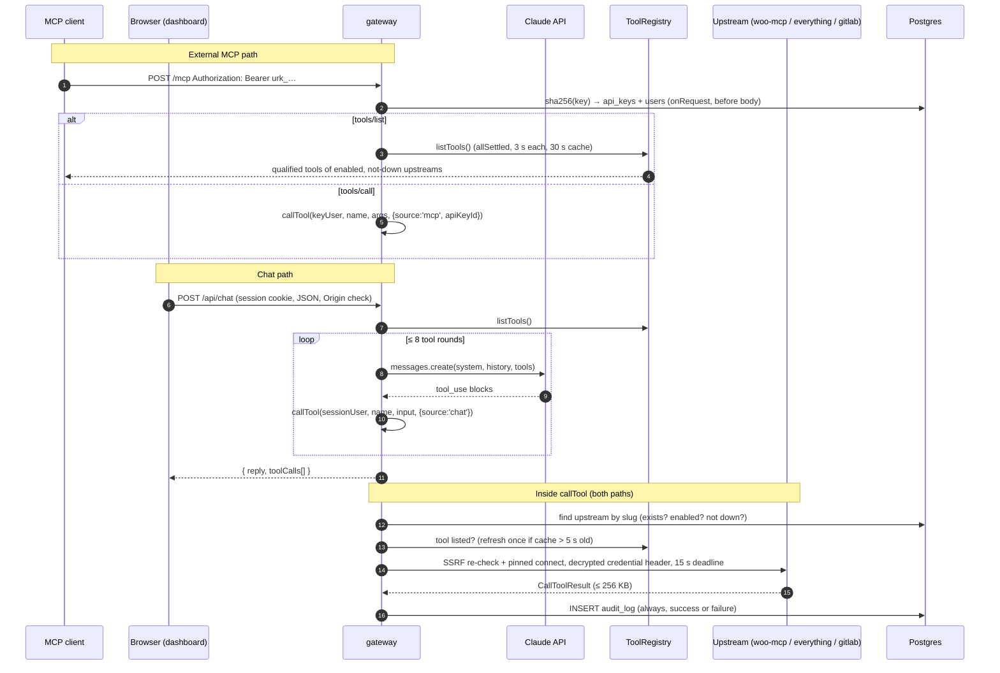
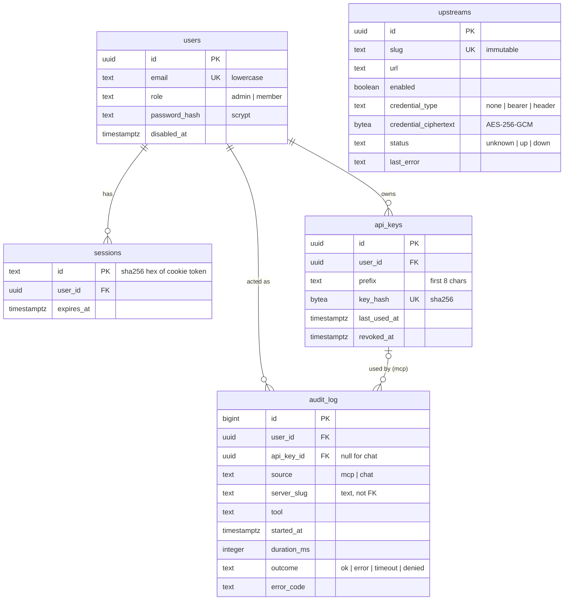

# Design

Requirements R3, W4, G3 (`docs/REQUIREMENTS.md`). Decisions are recorded in
[ADR 000](adr/000-phase1-decisions.md) (planning choices), [ADR 001](adr/001-contracts.md)
(contracts: API, naming, auth, schema) and [ADR 002](adr/002-upstreams.md) (upstreams 2 and 3).
Security analysis: [`THREAT_MODEL.md`](THREAT_MODEL.md). Every statement below names the file
that implements it.

## 1. Components

| Component         | Code                             | Role                                                                                                |
| ----------------- | -------------------------------- | --------------------------------------------------------------------------------------------------- |
| gateway           | `apps/gateway/src`               | Fastify server: admin/member API (`/api/*`), external MCP endpoint (`/mcp`), chat loop, health loop |
| dashboard         | `apps/dashboard/src`             | React + Vite + TanStack Query; static build served by nginx (`apps/dashboard/nginx.conf`)           |
| woo-mcp           | `apps/woo-mcp/src`               | Our WooCommerce MCP server: 5 tools over the WooCommerce REST API                                   |
| server-everything | `apps/everything/Dockerfile`     | MCP reference server 2.0.0, in-cluster, the D7 target                                               |
| GitLab MCP        | `https://gitlab.com/api/v4/mcp`  | Hosted third-party upstream, fine-grained PAT as bearer                                             |
| contracts         | `packages/contracts/src`, `sql/` | zod schemas shared by all of the above; SQL migration                                               |
| chart             | `charts/platform`                | One Helm chart for every workload                                                                   |

## 2. Request flows: one call path

Both ways of running a tool end in the same function, `callTool(userId, qualifiedName, args,
{ source, apiKeyId })` (`apps/gateway/src/core/call-tool.ts`), created once in
`apps/gateway/src/server.ts` and shared by the MCP endpoint and the chat service. Its
`onCallFinished` hook writes the audit row (`apps/gateway/src/audit/hook.ts`) in a `finally`
block, so no path can skip it.

**External MCP endpoint** (`apps/gateway/src/mcp/endpoint.ts`). `POST /mcp`, stateless
Streamable HTTP with JSON responses and no `Mcp-Session-Id` (ADR 001). The bearer key is checked
in `onRequest`, before the 1 MB body is read. Each request gets a fresh SDK `McpServer` bound to
the key's user, so a revoked key fails on its very next request. A `GatewayError` from
`callTool` becomes an `isError` tool result carrying the error envelope. `GET`/`DELETE` → 405.
Upstream `instructions` are never forwarded.

**Chat** (`apps/gateway/src/chat/service.ts`, `routes.ts`). The browser resends the
conversation (≤ 40 messages, ≤ 8000 chars each by contract; ≤ 64 KB total, checked in
`checkHistory`). The gateway runs one Anthropic Messages tool loop with the registry's current
tool set and calls `callTool(sessionUser.id, …, { source: 'chat' })` for every `tool_use`. It
returns the reply plus `toolCalls` (name, server, outcome, duration, error code), which the
dashboard lists under **Tools used** (`apps/dashboard/src/pages/Chat.tsx`).

| Chat limit                    | Value                                     | Where                             |
| ----------------------------- | ----------------------------------------- | --------------------------------- |
| Model                         | `CHAT_MODEL`, default `claude-sonnet-5-5` | `chat/service.ts`, `values*.yaml` |
| `max_tokens` per turn         | 1024                                      | `CHAT_MAX_TOKENS`                 |
| Tool rounds per request       | 8, then a "stopped after 8 rounds" note   | `MAX_TOOL_ROUNDS`                 |
| Tool result sent to the model | 16 KB UTF-8, marked `…[truncated]`        | `MAX_TOOL_RESULT_BYTES`           |
| History per request           | 64 KB of content                          | `MAX_HISTORY_CHARS`               |
| Anthropic call deadline       | 60 s, SDK retries included                | `ANTHROPIC_TIMEOUT_MS`            |
| Requests per user             | 20 per sliding minute → 429               | `chat/rate-limit.ts`              |
| No API key                    | `POST /api/chat` → 503                    | `chat/routes.ts`                  |

The system prompt (`systemPrompt()`) is fixed text plus the user's email and the current IST
time; no upstream content ever goes into it. Tool descriptions travel only as tool definitions
and results only as `tool_result` blocks.

## 3. Data model

`packages/contracts/sql/001_init.sql` and `002_tool_permissions.sql` (ADR 008), applied on gateway start by
`apps/gateway/src/db/migrate.ts` (advisory lock, `schema_migrations` table, idempotent).

- A CHECK (`upstreams_credential_complete`) keeps the ciphertext, IV, tag and header-name columns
  consistent with `credential_type`.
- `audit_log.server_slug` is plain text, so deleting an upstream keeps its audit history.
- The first admin is created from `SEED_ADMIN_EMAIL` / `SEED_ADMIN_PASSWORD` only when no admin
  exists (`apps/gateway/src/db/seed.ts`); it never updates an existing user.

## 4. Store connectivity (W4): REST API + Application Password

woo-mcp talks to WooCommerce only through its REST API (`/wp-json/wc/v3`,
`apps/woo-mcp/src/woo-client.ts`, 10 s timeout per request) as a dedicated WordPress user
`woo-mcp` with role `shop_manager`, authenticated by an Application Password. The bootstrap Job
(`charts/platform/files/bootstrap/bootstrap.sh`, `publish-secret.sh`) creates the user and
password and publishes them only into Secret `urumi-woo-api` (`WOO_URL`, `WOO_USER`,
`WOO_APP_PASSWORD`), then verifies `GET /wp-json/wc/v3/orders` returns 200.

| Option                                       | For                                                                                                                                                                                                        | Against                                                                                                                                                                        |
| -------------------------------------------- | ---------------------------------------------------------------------------------------------------------------------------------------------------------------------------------------------------------- | ------------------------------------------------------------------------------------------------------------------------------------------------------------------------------ |
| **REST API + Application Password** (chosen) | Supported, versioned interface; WooCommerce validation, hooks, stock and emails run; woo-mcp needs only HTTP; credential scoped to one least-privilege user and revocable without touching the admin login | HTTPS required unless `WP_ENVIRONMENT_TYPE=local`; one HTTP hop per call                                                                                                       |
| WP-CLI                                       | Full power, no HTTP auth to set up                                                                                                                                                                         | Needs a shell and the WordPress code in the caller's pod; a long-running service would exec into WordPress. Fine for a one-off Job — the bootstrap uses it — not for a service |
| Direct DB (MariaDB)                          | Fast                                                                                                                                                                                                       | Skips WooCommerce's business logic; couples us to its schema (e.g. HPOS order tables); woo-mcp would need DB credentials                                                       |

In production WordPress is served over HTTPS but woo-mcp calls it in-cluster over plain HTTP, so
it sends `X-Forwarded-Proto: https` (`wooMcp.forwardedProto`) and can override the `Host` header
(`wooMcp.hostHeader`, `apps/woo-mcp/src/host-override-fetch.ts`).

woo-mcp's tools (`apps/woo-mcp/src/tools/`): `list_products`, `create_product`, `list_orders`,
`get_order`, `update_order_status`. "Today" for `list_orders` is the Asia/Kolkata calendar day
by `date_created` (`apps/woo-mcp/src/store-time.ts`).

## 5. Tool naming and collisions (G3)

Implemented in `packages/contracts/src/naming.ts`, applied in
`apps/gateway/src/core/registry.ts`.

- **Format** `{slug}__{tool}`, e.g. `woo__list_orders`, `everything__echo`. Two upstreams
  exposing the same tool name never collide because slugs are unique (DB `UNIQUE`) and part of
  the name.
- **Slug** `^[a-z0-9](?:[a-z0-9-]{0,18}[a-z0-9])?$`: 1–20 chars, no `_`, so the first `__` in a
  name always ends the slug and `parseQualifiedName` is unambiguous. Slugs are immutable
  (`UpdateUpstreamRequestSchema` is strict and has no `slug`), because they are in every tool
  name and audit row.
- **Sanitising** Tool characters outside `[a-zA-Z0-9_-]` become `_`, so every name fits
  Claude's `^[a-zA-Z0-9_-]{1,64}$`.
- **Length** If `slug__tool` is over 64 chars, the tool part is truncated and suffixed with `_` +
  8 hex chars of FNV-1a 32-bit over the original tool name's UTF-8 bytes. FNV-1a is
  non-cryptographic; it only has to separate tools within one server and runs in the browser.
- **Routing never reverses sanitising.** The registry keeps qualified → original name per tool
  and `callTool` sends the original (`tool.originalName`).
- **Collisions within one upstream after sanitising** (`foo.bar` and `foo_bar`): the first one in
  the upstream's order is kept, the second is dropped with a warning log
  (`duplicate qualified tool name after sanitising`).
- The chat service additionally skips any tool whose name fails Claude's regex or whose
  `inputSchema.type` is not `object` (`toAnthropicTools`).
- **Reserved slug `gateway`** (ADR 012): the gateway's own meta-tools `gateway__search_tools` and
  `gateway__call_tool`; an upstream cannot be created with it.
- **Many tools: discovery mode** (ADR 012). `/mcp?mode=discovery` (or header
  `x-urumi-tool-mode: discovery`) lists only the two meta-tools: a BM25 keyword search over the
  caller's permitted tools, and a call that goes through `callTool` (permissions, timeout, audit
  of the real tool). The chat agent switches to it when a user's permitted tools exceed
  `CHAT_DISCOVERY_THRESHOLD` (default 40) and reports the real tools executed. D12 proves it on
  142 tools.

## 6. Failure isolation (G4)

| Mechanism                                                           | Value                                                                                                                         | Where                                                  |
| ------------------------------------------------------------------- | ----------------------------------------------------------------------------------------------------------------------------- | ------------------------------------------------------ |
| Parallel listing, failures omitted                                  | `Promise.allSettled` over upstreams                                                                                           | `ToolRegistry.listTools` (`core/registry.ts`)          |
| List timeout (whole op: SSRF check, DNS, connect, initialize, list) | 3 s                                                                                                                           | `MCP_TIMEOUTS.listMs`, `mcp-client/upstream-client.ts` |
| Call timeout (same scope)                                           | 15 s → `UPSTREAM_TIMEOUT`                                                                                                     | `MCP_TIMEOUTS.callMs`, `core/call-tool.ts`             |
| DNS timeout inside the SSRF guard                                   | 3 s (or less, within the deadline)                                                                                            | `upstreams/ssrf.ts`                                    |
| Health loop                                                         | every 15 s after the previous pass ends, each upstream pinged with `tools/list` (3 s) in parallel                             | `core/health.ts`                                       |
| Down upstreams' tools                                               | hidden from every listing and refused by `callTool` (`UPSTREAM_UNREACHABLE`)                                                  | `isListable()`                                         |
| Tool cache                                                          | 30 s, keyed to `updated_at`, so any edit invalidates it; concurrent fetches shared                                            | `core/registry.ts`                                     |
| Pagination cap on `tools/list`                                      | 10 pages                                                                                                                      | `MAX_LIST_PAGES`                                       |
| Tools kept per upstream                                             | 200                                                                                                                           | `core/limits.ts`                                       |
| `inputSchema` size                                                  | > 16 KB → tool dropped                                                                                                        | `core/limits.ts`                                       |
| Tool result size                                                    | > 256 KB → `UPSTREAM_ERROR` "Tool result too large"                                                                           | `core/limits.ts`, `core/call-tool.ts`                  |
| Descriptions                                                        | control/format/bidi chars removed, ≤ 500 code points                                                                          | `sanitizeDescription`                                  |
| Error text to clients and `last_error`                              | fixed vocabulary (`Timed out`, `HTTP 403`, `Connection failed (ECONNREFUSED)`, …); never URL, IP, credential or upstream text | `classify()` in `upstream-client.ts`                   |

A health result is written only if the row's URL and credential did not change during the check
(`setUpstreamHealth`), so an admin edit is never overwritten by a stale result. The dashboard's
**Upstreams** page polls every 15 s. Measured by `tests/infra/upstreams.sh` (ADR 002): a killed
`everything` pod shows `down` after 12 s and `up` 18 s after it returns.

## 7. Authentication and roles (T1, T2)

**Dashboard sessions** (`apps/gateway/src/auth/session.ts`, `routes.ts`, `password.ts`).
Email + password, scrypt (N=16384, r=8, p=1, 16-byte salt). Login returns a random 32-byte token
in cookie `urumi_session` (`HttpOnly; SameSite=Lax`, `Secure` when `COOKIE_SECURE=true`,
12 h). The DB stores only sha256 of the token. Every request re-reads the user, so disable, role
change and logout apply immediately; disabling a user also deletes their sessions; changing a
password deletes the user's other sessions. A Cookie header with two `urumi_session` values is
refused (cookie tossing). Login throttle (`auth/login-limiter.ts`, in memory): 10 attempts per
email and 30 failures per client IP per 15 min; a refusal looks exactly like a wrong password,
and unknown emails cost one scrypt like real ones.

**CSRF** (`apps/gateway/src/http/csrf.ts`). On every POST/PUT/PATCH/DELETE except the `/mcp`
route: a body must be `application/json` (cross-origin browsers need a preflight for that, which
is never granted) and a present `Origin` must equal `PUBLIC_ORIGIN`.

**Roles.** `requireAdmin` guards upstream create/edit/delete, member management, and other users'
keys. Members can list upstreams (without `url`), tools, their own keys, and their own audit rows
(`audit/routes.ts` replaces a member's `userId` filter with their own id). An admin cannot demote
or disable themselves, and the last active admin cannot be removed (row-locked,
`users/routes.ts`). There is no self-signup: admins create members and get a one-time
`tempPassword` (16 random bytes).

**Tool permissions** (ADR 008; `packages/contracts/src/permissions.ts`,
`apps/gateway/src/permissions/`, `core/visible-tools.ts`). Rules in `tool_permissions`
(role or user × server or `*` × tool / `prefix*` / `*` × allow/deny); a user's own rules override
the role's, the most specific rule wins, deny wins ties, and no match means deny. Default: admins
everything; members only read tools (`woo__list_products`, `woo__list_orders`, `woo__get_order`,
everything's harmless tools, GitLab `get_*` / `list_*` / search). Every tool list (MCP
`tools/list`, chat tool set, `/api/tools`, `/api/upstreams/:id/tools`) is filtered by
`listToolsFor(userId)`, and `callTool` rejects a disallowed name with `FORBIDDEN` before touching
the upstream, audited as `denied`. Admins edit rules at `/api/permissions` (dashboard
**Permissions**, with an effective-access preview using the same evaluator). Proven by D9.

**API keys** (`apps/gateway/src/auth/api-keys.ts`, `keys/`). `urk_` + base64url(32 random
bytes), returned once by `POST /api/keys`. The DB keeps sha256 (`key_hash`, unique) and an 8-char
`prefix` for display. Only the exact form `Bearer urk_<43 chars>` is looked up. A key is accepted
only if not revoked and its user is not disabled. Revoking sets `revoked_at` (own keys, or any
user's as admin); another user's key id answers 404. `last_used_at` is updated at most once a
minute, fire-and-forget.

## 8. Upstream credentials (G5)

- **Encryption** (`apps/gateway/src/crypto/secretbox.ts`): AES-256-GCM, fresh random 12-byte IV
  per write, 16-byte tag, AAD = the upstream's id, so a ciphertext copied to another row fails to
  open. Key: `GATEWAY_ENC_KEY` (base64 of exactly 32 bytes, validated in `config.ts`), from Secret
  `urumi-env`.
- **Use**: decrypted only in `upstreams/decrypt-for-call.ts`, just before an outbound request,
  and sent as `Authorization: Bearer …` or the configured header. Header names that the gateway
  controls (Host, Content-Type, `Mcp-*`, …) and CR/LF/NUL in values are rejected by the contracts
  schema (ADR 001).
- **Never returned**: `UpstreamSchema` is strict and exposes only `credentialType` /
  `hasCredential`; request bodies are not logged and `credential` paths are redacted
  (`LOGGER_OPTIONS` in `server.ts`).
- **Host change**: changing an upstream's URL to a different origin (scheme, host or port) while a
  credential is stored is refused unless the admin re-enters or removes the credential
  (`upstreams/routes.ts`), so a token cannot be redirected to a new server. Path-only changes keep
  it.
- **Seeding**: `tests/e2e/seed-upstreams.sh` reads `WOO_MCP_SHARED_SECRET` and `GITLAB_MCP_TOKEN`
  from the Kubernetes Secret and sends them once through the admin API; the gateway pod does not
  get `GITLAB_MCP_TOKEN` as an env var (ADR 002).

## 9. Audit (T3)

One `audit_log` row per `callTool` invocation, written before the caller gets the result
(`core/call-tool.ts` → `audit/hook.ts` → `audit/repo.ts`).

| Case                                                                   | `outcome`      | `error_code`                                                 |
| ---------------------------------------------------------------------- | -------------- | ------------------------------------------------------------ |
| Upstream returned a result                                             | `ok`           | null                                                         |
| Upstream returned `isError: true`                                      | `error`        | `UPSTREAM_ERROR`                                             |
| Upstream error, unreachable, result too large                          | `error`        | `UPSTREAM_ERROR` / `UPSTREAM_UNREACHABLE`                    |
| 15 s deadline passed                                                   | `timeout`      | `UPSTREAM_TIMEOUT`                                           |
| Unknown tool / unqualified name, disabled server, non-object arguments | `denied`       | `TOOL_NOT_FOUND` / `UPSTREAM_DISABLED` / `VALIDATION_FAILED` |
| Anything unexpected                                                    | `error`        | `INTERNAL`                                                   |
| `/mcp` request over the per-key / per-user limit (ADR 010)             | `rate_limited` | `RATE_LIMITED` (server `gateway`, tool `mcp`)                |

Each row has user, API key (MCP) or null (chat), source, server slug (`unknown` if the name did
not parse), the upstream's original tool name (capped at 200 chars), start time, duration,
outcome, error code and **error detail** (ADR 011): the fixed-vocabulary reason — `Timed out`,
`Host did not resolve`, `Connection failed (ECONNREFUSED)`, `HTTP 503`, `MCP error -32603`,
`Tool returned an error`, `Not permitted`, … — classified for the API (`errorReason`) and the
Health / Metrics page. Never upstream text.

**Not logged:** tool arguments and results (customer data, ADR 001); `tools/list` calls;
requests with a missing, revoked or unknown key (no user to attribute them to — they are a 401 in
the HTTP log only, so D5's rejected call has no audit row); Anthropic calls; admin actions such as
creating users, revoking keys or editing upstreams. If the audit insert fails, the tool result is
still returned and the row's fields go to the error log.

`GET /api/audit` is keyset-paginated (`started_at desc, id desc`) with filters for user, server,
tool, outcome and time range (`audit/repo.ts`); members only ever see their own rows.

## 10. Kubernetes layout

One chart, `charts/platform`; differences between local and VPS live only in `values-local.yaml`
and `values-prod.yaml` (README "Local → VPS").

| Workload           | Kind                                        | Probes                                                                  | Notes                                                                                                  |
| ------------------ | ------------------------------------------- | ----------------------------------------------------------------------- | ------------------------------------------------------------------------------------------------------ |
| `urumi-mariadb`    | StatefulSet, PVC                            | liveness + readiness                                                    | official `mariadb` image                                                                               |
| `urumi-wordpress`  | Deployment, PVC (whole docroot)             | liveness + readiness                                                    | official `wordpress` image, non-root (uid 33); Ingress `store.<host>`                                  |
| `urumi-bootstrap`  | Job (Helm `post-install,post-upgrade` hook) | — (Jobs exempt)                                                         | installs WP + WooCommerce (pinned version), COD, publishes `urumi-woo-api`, scales woo-mcp             |
| `urumi-postgres`   | StatefulSet, PVC                            | liveness + readiness                                                    | NetworkPolicy: gateway pods only, TCP 5432                                                             |
| `urumi-woo-mcp`    | Deployment                                  | `/healthz`                                                              | 0 replicas until `urumi-woo-api` exists (`lookup`); NetworkPolicy: gateway pods only, 8080; no Ingress |
| `urumi-everything` | Deployment                                  | TCP                                                                     | NetworkPolicy: gateway pods only, 3001; no Ingress; read-only root FS                                  |
| `urumi-gateway`    | Deployment, 2 replicas (local/prod), PDB    | startup + liveness `/healthz`, readiness `/readyz` (DB `SELECT 1`, 1 s) | Ingress `app.<host>` `/api`, `/mcp`; soft anti-affinity; `preStop` drain (ADR 010)                     |
| `urumi-dashboard`  | Deployment                                  | liveness + readiness                                                    | Ingress `app.<host>` `/`                                                                               |

- **Requests and limits** on every container (`values.yaml`); `tests/infra/chart-checks.sh`
  renders both values files and fails if any Deployment/StatefulSet container lacks liveness,
  readiness, requests or limits, or if the chart renders a `Secret`.
- **Secrets**: the chart only references existing Secrets: `urumi-env` (from `.env.local` via
  `scripts/secrets-apply.sh`, or created out-of-band in prod) and `urumi-woo-api` (written by the
  bootstrap Job). Pods without API needs have `automountServiceAccountToken: false`.
- **Bootstrap RBAC** (`templates/bootstrap/rbac.yaml`): `get/patch/update` on Secret
  `urumi-woo-api` only; `create` on Secrets in the namespace (Kubernetes cannot scope `create` by
  name); `get/patch/update` on the `urumi-woo-mcp` Deployment and its scale. Only the Job's
  kubectl container gets a projected token.
- **NetworkPolicies** (ADR 009, `templates/networkpolicy/`, `networkPolicy.enabled`, on in both
  values files): a namespace-wide **default deny for ingress and egress**, DNS egress for every
  pod, and one allow per real flow — Traefik → dashboard / gateway (+ canary) / WordPress;
  gateway → Postgres, woo-mcp, everything, internet 80/443; woo-mcp → WordPress; WordPress →
  MariaDB (+ internet); bootstrap Job → MariaDB, WordPress, Kubernetes API, internet. "Internet"
  excludes private, CGNAT, link-local and loopback ranges. Postgres, MariaDB, everything and the
  dashboard have no egress. k3s's kube-router enforces them; `tests/infra/netpol-default-deny.sh`
  proves an unlabelled pod reaches nothing and a gateway-labelled pod reaches only its three
  backends (output in `docs/NETWORK_POLICIES.md`); `tests/infra/chart-checks.sh` fails if a
  workload has no allow policy.
- **Non-root**: every long-running container runs as a non-root uid. WordPress runs as www-data
  (33) with all capabilities dropped and binds port 80 through the safe pod sysctl
  `net.ipv4.ip_unprivileged_port_start=0` (`wordpress.runAsNonRoot`, ADR 009).
- **Several gateway replicas** (ADR 010, `gateway.replicas`): any replica serves any request —
  `/mcp` is stateless Streamable HTTP, and what replicas must agree on lives in Postgres: the `/mcp`
  token buckets (`rate_limit_buckets`, per key and per user, one atomic UPSERT per bucket, 429 +
  `Retry-After`, audited `rate_limited`) and the `health` lease (`gateway_leases`): only the
  holder runs the 15 s health loop and writes upstream status; followers read status from the
  row. Tool caches stay per replica (correctness comes from the row). D10 proves it on k3d.
- **Metrics** (ADR 011): each gateway pod serves Prometheus `GET /metrics` on internal port 9464
  (`tool_calls_total`, `tool_call_duration_seconds`, `upstream_up`, last-check/last-success
  timestamps, `rate_limited_total`, process metrics), exposed by Service
  `<release>-gateway-metrics` only — never by the Ingress — and admitted by NetworkPolicy only
  from pods labelled `urumi.io/metrics-scraper: "true"`. Per pod; sum over pods. Optional
  `ServiceMonitor` (off). The admin **Health / Metrics** page computes per-server calls, error
  rate and p50/p95 from `audit_log` (all replicas) and shows each upstream's classified last
  failure and last success.
- **SSRF allow-list**: `UPSTREAM_ALLOWED_HOSTS` defaults to `*.<namespace>.svc.cluster.local` so
  in-cluster upstreams pass the private-address check.

## 11. Tradeoffs and what we would do with more time

| Decision                              | Gained                                                | Cost / next step                                                                         |
| ------------------------------------- | ----------------------------------------------------- | ---------------------------------------------------------------------------------------- |
| Stateless `/mcp`, no sessions         | Key re-checked on every request; no sticky routing    | No `tools/list_changed` push; clients re-list to see D6                                  |
| New upstream connection per operation | Simple, no shared state, isolation per call           | Extra `initialize` round trip per call; sessions are closed without `DELETE` (see below) |
| Shared state in Postgres, not Redis   | No new stateful dependency; replicas agree (ADR 010)  | Two small UPSERTs per `/mcp` POST; chat limit and login throttle still per replica       |
| Per-tool permissions read per request | A rule change applies on the next call; one code path | One small policy query per `tools/list` / `tools/call` (ADR 008); no per-API-key scopes  |
| Request/response chat                 | Simple, stateless                                     | No streaming; long tool loops show nothing until done                                    |
| Metadata-only audit                   | No second store of customer data                      | Cannot replay what a tool was asked; admin actions are not audited                       |
| Static bearer for GitLab              | No OAuth flow in the gateway                          | Token expiry is manual rotation (update Secret, re-run seed)                             |

With more time: terminate upstream MCP sessions (`DELETE`) after each operation; stream-cap
response bodies before parsing; audit admin actions; move the chat limit and login throttle to
the shared token buckets;
append-only audit role in Postgres; per-API-key scopes;
confirmation step for write tools in chat; KMS-backed or rotatable `GATEWAY_ENC_KEY`; image
build + e2e in CI; a real VPS run (#25).

**Known gap: upstream sessions are not terminated.** ADR 002 measured that server-everything
keeps every un-terminated session in memory (≈ 0.06 MiB each) and expected the fix in the
gateway client. `apps/gateway/src/mcp-client/upstream-client.ts` still calls only
`client.close()`, never `transport.terminateSession()`. With one health ping per 15 s plus calls,
the `everything` pod grows toward its 192 Mi limit (ADR 002 estimates an OOM kill about every 10
hours); Kubernetes restarts it and the health loop reports the gap.

## 12. Upgrades and rollback

One Helm release (`urumi`) holds every component, so every change — image, values, chart — is one
numbered revision (`helm history`). The same commands work locally and on a VPS; only the values
file differs.

**Upgrade.** `helm upgrade --install urumi charts/platform -n urumi -f <values> --wait`. What
happens per component:

| Component                                               | On upgrade                                                                                                                             | On `helm rollback <rev>`                                                      |
| ------------------------------------------------------- | -------------------------------------------------------------------------------------------------------------------------------------- | ----------------------------------------------------------------------------- |
| gateway, dashboard, woo-mcp, everything                 | Deployment rolling update (new pod Ready before the old one goes)                                                                      | same rolling update back to the old pod template                              |
| WordPress                                               | `Recreate` (the docroot PVC is ReadWriteOnce): a few seconds without a storefront                                                      | same                                                                          |
| MariaDB, Postgres                                       | StatefulSet rolling update of pod 0; data stays on the `volumeClaimTemplates` PVC                                                      | pod spec only; **data is not rolled back**                                    |
| WordPress docroot PVC                                   | unchanged (`helm.sh/resource-policy: keep`, also survives `helm uninstall`)                                                            | unchanged                                                                     |
| Gateway schema                                          | new `packages/contracts/sql/NNN_*.sql` files applied on start, once, under a Postgres advisory lock (`apps/gateway/src/db/migrate.ts`) | **not reverted** (no down-migrations): the old image runs on the newer schema |
| Store bootstrap (Job, `post-install,post-upgrade` hook) | re-runs after every install/upgrade; idempotent: checks state first, keeps a still-working Application Password, re-scales woo-mcp     | **does not run** (no `post-rollback` hook); the store keeps its state         |
| Secrets `urumi-env`, `urumi-woo-api`                    | never rendered by the chart; untouched                                                                                                 | untouched                                                                     |
| NetworkPolicies, RBAC, Ingress                          | created/updated/deleted to match the chart                                                                                             | restored to the old revision's set (verified: README "Upgrades and rollback") |

**Rules that keep rollback safe.**

1. Migrations are additive (expand, then contract in a later release): add tables/columns with
   defaults, never drop or rename what the previous release reads. Then rolling the gateway back
   one revision is always safe; data written by the newer release is ignored, not lost.
2. The hook must stay idempotent and must not depend on running after a rollback.
3. Immutable fields — StatefulSet `volumeClaimTemplates` (storage size, class) and every
   `selector` — cannot change through `helm upgrade`. A PVC is resized with `kubectl patch pvc`
   on a StorageClass with `allowVolumeExpansion`; a selector change needs a new object name.
4. A failed upgrade (`--wait` timeout or failed hook) leaves the revision `failed`; recover with
   `helm rollback urumi <last deployed rev>` after reading `kubectl get events` and the failing pod's
   logs. `--atomic` would do this automatically but also hides the failed state, so it is not the
   default here.
5. Back up before risky upgrades: `kubectl -n urumi exec urumi-postgres-0 -- pg_dump -U gateway
gateway > gateway.sql` and `kubectl -n urumi exec urumi-mariadb-0 -- mariadb-dump …`. Restores
   are manual; there is no scheduled backup in the chart.

**Automated rollback of gateway releases (CI canary, ADR 003/005).** On `main`, the `canary` job
builds a throwaway k3d cluster, installs the last promoted commit as stable, seeds users and
today's orders, then deploys the new gateway image as `urumi-gateway-canary` with 20 % of `/api`
and `/mcp` (Traefik `IngressRoute`). `scripts/canary/verdict.py` sends real `woo__list_orders`
calls with a member's key and compares the tracks (error rate, p95 latency, tool success):

- **PROMOTE** → `scripts/canary/run.sh promote <tag>`: the stable image becomes the canary's tag
  and the canary is disabled (a Helm upgrade with `--reset-then-reuse-values --no-hooks`).
- **ROLLBACK** or **HOLD** → `scripts/canary/run.sh rollback`: the canary is disabled, stable is
  untouched; the job fails, which opens an incident and starts the Duo incident flow (ADR 007).
- A PROMOTE of a high-risk change is rolled back and waits for `release:human-approval`.

The canary only exercises the gateway; chart-wide changes (NetworkPolicies, StatefulSets) are
verified by the e2e suite on the local cluster and rolled back with `helm rollback`.
