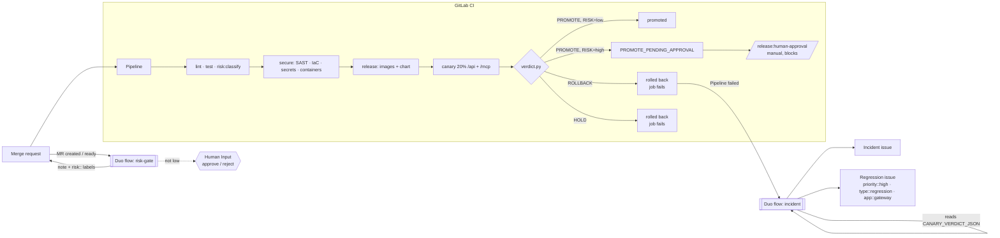

# Hackathon story: from commit to canary verdict, risk gate and incident

Issues #22 (H1), #23 (H2), #24 (H3). ADRs: [003 canary](adr/003-canary.md),
[004 Duo flows](adr/004-duo-flows.md).

## The story in one pipeline

1. **Test.** `lint` (ESLint, Prettier, typecheck) and `test` (unit, contract and integration
   tests against a real Postgres). `release:config-tests` checks the CI and flow definitions,
   `canary:unit-tests` the canary scripts. `risk:classify` labels the change `high` or `low`.
2. **Secure.** Secret Detection, SAST, IaC scanning, and Container Scanning of every pushed
   image. A scan that can't run blocks the release.
3. **Package.** Images are built with rootless BuildKit and pushed as `:<short sha>` (main) or
   `:X.Y.Z` (tags). The Helm chart is pushed as an OCI artifact, and released versions are never
   overwritten.
4. **Canary.** `canary` starts an ephemeral k3d cluster in the job, installs the stable release,
   then deploys this commit as a second gateway Deployment. A Traefik weighted route sends it
   **20 % of `/api` and `/mcp`**.
5. **Verdict.** `scripts/canary/verdict.py` sends real `tools/call woo__list_orders` traffic and
   compares error rate, p95 latency and tool success per track. The result is **PROMOTE**,
   **ROLLBACK** or **HOLD**.
6. **Risk gate.** A PROMOTE of a **high-risk** change (auth, keys, users, crypto, HTTP/MCP
   surface, SSRF guard, NetworkPolicy, values, RBAC, Secrets, CI) is not promoted. The result is
   `PROMOTE_PENDING_APPROVAL`, and the pipeline waits at the manual **`release:human-approval`**
   job. The Duo **risk-gate** flow explains why on the MR.
7. **Incident.** A ROLLBACK fails the job (`RELEASE REJECTED: canary rolled back`) and so fails
   the pipeline. The Duo **incident** flow reads the verdict from the job log and opens an
   **incident** and a **`priority::high` regression issue**.

## What lives where

| Piece                                   | File                                                     |
| --------------------------------------- | -------------------------------------------------------- |
| Canary job, drill, risk + approval jobs | `.gitlab/ci/canary.gitlab-ci.yml`                        |
| Canary run (cluster, deploy, verdict)   | `scripts/canary/ci.sh`, `run.sh`, `verdict.py`           |
| Verdict record + log line               | `scripts/canary/record.jq` → `CANARY_VERDICT_JSON: {..}` |
| Risk classifier                         | `scripts/canary/risk.py` (`--list-globs` prints rules)   |
| Approval record                         | `scripts/canary/approval.py` → `approval.json`           |
| Flows                                   | `.gitlab/flows/incident.yaml`, `risk-gate.yaml`          |
| Flow policy + rule parity test          | `.gitlab/flows/tests/flows.test.sh`                      |

`release:human-approval` on main is always created, because a dotenv value can't decide whether
a job exists. It is a no-op (`low risk: no approval needed`) when `RISK=low`, and is skipped
when the canary failed. On MR pipelines it exists only when the diff touches a high-risk glob,
and it approves the merge.

## Register the flows (Aadi, 5 min)

Prerequisites (once): Duo Agent Platform is on for the group, and GitLab Credits are available.
Custom flows are allowed: group **Settings > GitLab Duo > Change configuration > Allow custom
flows**. You need the Maintainer role in the project.

1. **Create the incident flow.** Project **AI > Flows > New flow**.
   - Display name `Canary incident`. Description `Rollback -> incident + priority::high
regression issue`.
   - Visibility **Private**.
   - Configuration: select **Flow**, then paste all of `.gitlab/flows/incident.yaml`.
   - **Create flow**.
2. **Create the risk-gate flow** the same way. Display name `Release risk gate`, Visibility
   **Private**, paste `.gitlab/flows/risk-gate.yaml`, **Create flow**.
3. **Enable each flow in the project, with its trigger.** **AI > Flows > Managed** tab, then
   select the flow, then **Enable** (upper right).
   - Project: this project.
   - **Canary incident**: Add triggers, event type **Pipeline events**, action **Failed**.
   - **Release risk gate**: Add triggers, event type **Merge request**, action **Created**. Add
     a second trigger with event type **Merge request ready** (if your version lists "Marked
     ready" as an action of Merge request, use that instead).
   - Leave Instructions empty. The YAML carries the instructions.
   - **Enable**. GitLab creates the flow's service account (`ai-<flow>-<group>`) and adds it to
     the project as Developer. If the trigger form asks for a **service account**, pick that one.
   - If your version has a separate **AI > Triggers > New flow trigger** page, choose the same
     flow, event and action there.
4. **Project settings for the gate.** **Settings > Merge requests > Merge checks > Pipelines
   must succeed**, so a blocked high-risk MR pipeline can't be merged. Optional: create the
   labels `priority::high`, `type::regression`, `app::gateway`, `incident`, `canary::rollback`,
   `risk::high`, `risk::low` and `gate::infra` in **Manage > Labels** to pick colours. GitLab
   creates missing labels on use anyway.

## Demo script

**(a) Risk gate on an MR.**

1. Branch, change one line in `apps/gateway/src/auth/session.ts` (a comment is enough), push,
   and open an MR.
2. Within a minute or two the **Release risk gate** session posts a note: `Release risk gate:
HIGH`, the matched path, and what reviewers should check. It also adds the labels `risk::high`
   and `gate::infra`. The flow's session page (from the project's AI menu) waits for **Human
   Input**. Approve it, and a second note records the decision.
3. The MR pipeline shows `risk:classify` with `RISK: high` and the matched path, and then
   **blocked** at `release:human-approval`. Run it: the log says `APPROVED by @<you>: merge of
high-risk change (...)`, and `approval.json` is attached. Only then does the pipeline pass.
4. Contrast: an MR that only touches `docs/` gets `Release risk gate: LOW` and `risk::low`, and
   has no approval job.

**(b) Rollback opens an incident.**

1. Open the latest **main** pipeline, then click play on **`canary:bad-release`**.
2. When the job finishes (it builds a whole cluster, so allow several minutes), its log ends with `CANARY VERDICT: ROLLBACK -> ROLLBACK,
rolled-back`, the `CANARY_VERDICT_JSON: {...}` line, and `ERROR: RELEASE REJECTED: canary rolled
back`. The job and the pipeline are **failed**.
3. The **Canary incident** session starts. The issue list then shows `Incident: canary rolled back
on main (<sha>)`, marked as a drill, with the reasons, a stable-vs-canary table, links, the
   timeline and the impact ("20% of /api and /mcp ... from <live> to <rolled back>"). It also
   shows `Regression: gateway canary rejected at <sha> on main`, labelled `priority::high`,
   `type::regression` and `app::gateway`, which links the incident and gives a first
   investigation step.
4. Re-running the flow for the same pipeline creates nothing new (it searches first).

## Honest limits

- The flows need Duo Agent Platform, custom flows turned on, and GitLab Credits. They are
  registered by hand in the UI: the repo copy is the source, and the UI copy can drift. Re-paste
  after changes.
- Triggers fire only on actions that a person started. Pushes, merges, "Run pipeline" and
  clicking a manual job all count. Scheduled pipelines and bot activity don't.
- Main pipelines show **blocked** until someone runs the manual `canary:bad-release` (and on main
  `release:human-approval`). Both are manual jobs with `allow_failure: false`. See ADR 004.
- A drill always fails its job, even when it worked. Read `DECISION` or the log.
- The CI cluster is ephemeral. "Promote" is the verdict plus the approval record, not a deploy to
  a long-lived production cluster. Stable and canary come from the same commit, with faults
  injected for the drill.
- The flow's Human Input approval is recorded on the MR, but it can't run the CI job. The
  enforcing gate is `release:human-approval`. Anyone allowed to run jobs on that ref can run it.
  Use a protected environment with approval rules (Premium) for strict separation of duties.
- The flows have been checked by `flows.test.sh` (schema rules, tool names, routes) but not
  executed on GitLab from this repo. Agent behaviour (exact answers, tool parameters such as
  incident type or add-labels) is resolved at run time, and the prompts include fallbacks.
