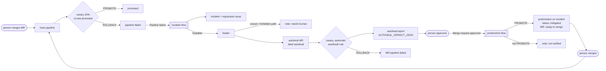
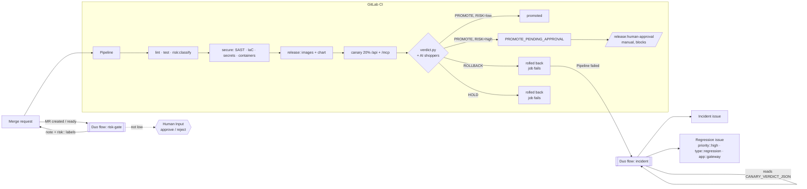

# Hackathon story: from commit to canary verdict, risk gate and incident

Issues #22 (H1), #23 (H2), #24 (H3), #28 (self-healing), #29 (AI shoppers). ADRs:
[003 canary](adr/003-canary.md), [004 Duo flows](adr/004-duo-flows.md),
[005 self-healing](adr/005-self-healing.md), [006 AI shoppers](adr/006-ai-shoppers.md).

## The story in one pipeline

1. **Test.** `lint` (ESLint, Prettier, typecheck) and `test` (unit, contract and integration
   tests against a real Postgres). `release:config-tests` checks the CI and flow definitions,
   `canary:unit-tests` the canary scripts. `risk:classify` labels the change `high` or `low`.
2. **Secure.** Secret Detection, SAST, IaC scanning, and Container Scanning of every pushed
   image. A scan that can't run blocks the release.
3. **Package.** Images are built with rootless BuildKit and pushed as `:<short sha>` (main) or
   `:X.Y.Z` (tags). The Helm chart is pushed as an OCI artifact, and released versions are never
   overwritten.
4. **Canary.** `canary` starts an ephemeral k3d cluster in the job, installs the stable release,
   then deploys this commit as a second gateway Deployment. A Traefik weighted route sends it
   **20 % of `/api` and `/mcp`**.
5. **Verdict.** `scripts/canary/verdict.py` sends real `tools/call woo__list_orders` traffic and
   compares error rate, p95 latency and tool success per track. At the same time
   `scripts/canary/shoppers.py` sends **AI shoppers** (Claude personas) through each track to
   buy a product, check today's orders or look up a price. If far fewer of them succeed on the
   canary than on stable, the verdict rolls back and quotes the customer. The result is
   **PROMOTE**, **ROLLBACK** or **HOLD**.
6. **Risk gate.** A PROMOTE of a **high-risk** change (auth, keys, users, crypto, HTTP/MCP
   surface, SSRF guard, NetworkPolicy, values, RBAC, Secrets, CI) is not promoted. The result is
   `PROMOTE_PENDING_APPROVAL`, and the pipeline waits at the manual **`release:human-approval`**
   job. The Duo **risk-gate** flow explains why on the MR.
7. **Incident.** A ROLLBACK fails the job (`RELEASE REJECTED: canary rolled back`) and so fails
   the pipeline. The Duo **incident** flow reads the verdict from the job log and opens an
   **incident** and a **`priority::high` regression issue**.
8. **Heal.** In the same session, the **healer** finds the suspect gateway commit, explains the
   hunk against the verdict, and opens MR **`Autoheal: <root cause> (incident #N)`** (label
   `autoheal`) with the smallest fix (a targeted hunk revert). If it is unsure, or the suspect
   touched CI, charts or secrets, it comments "needs human" instead.
9. **Verify, approve, postmortem.** The autoheal MR's `canary` runs **automatically**: stable is
   the last promoted commit and the canary is the fix. A person approves. The Duo **postmortem**
   flow reads the verdict from `autoheal:report`. On PROMOTE it posts a blameless postmortem on
   the incident, labels it `status::mitigated`, and notes "verified by canary, ready to merge".
   A person merges.

The canary compares this commit with the **last promoted** one (stable is built from it) and
probes a store with **24 of today's orders**. Before #28 both tracks ran the same commit on an
empty store.

### The self-healing loop

## What lives where

| Piece                                   | File                                                                    |
| --------------------------------------- | ----------------------------------------------------------------------- |
| Canary job, drill, risk + approval jobs | `.gitlab/ci/canary.gitlab-ci.yml`                                       |
| Canary run (cluster, deploy, verdict)   | `scripts/canary/ci.sh`, `run.sh`, `verdict.py`                          |
| Verdict record + log line               | `scripts/canary/record.jq` → `CANARY_VERDICT_JSON: {..}`                |
| Risk classifier                         | `scripts/canary/risk.py` (`--list-globs` prints rules)                  |
| Approval record                         | `scripts/canary/approval.py` → `approval.json`                          |
| Flows                                   | `.gitlab/flows/incident.yaml`, `risk-gate.yaml`, `postmortem.yaml`      |
| Flow policy + rule parity test          | `.gitlab/flows/tests/flows.test.sh`                                     |
| Canary baseline + seeded orders         | `scripts/canary/ci.sh`, `seed-orders.sh`                                |
| Autoheal verdict for the postmortem     | `autoheal:report` → `scripts/canary/autoheal_report.py`                 |
| Autoheal CI policy test                 | `.gitlab/ci/tests/autoheal-ci.test.sh`                                  |
| Demo regression + offline check         | `scripts/demo/regression.sh`, `check-regression.mjs`, `README.md`       |
| AI shoppers + their verdict rule        | `scripts/canary/shoppers.py`, `verdict.py --shoppers`                   |
| Track pinning (CI only) + chart test    | `templates/app/canary-ingressroute.yaml`, `tests/infra/canary-chart.sh` |

### What the AI shoppers add

The probe asks "did `woo__list_orders` answer?". The shoppers ask "could a customer get their job
done?". Four personas run on each track, and every journey is pinned to one track with the
`X-Urumi-Track` header (a CI-only IngressRoute rule). They act only through real calls: the
gateway's `woo__*` tools with user B's key, and a Cash on delivery checkout through the Store API.
Each journey ends with the shopper's own verdict, and it counts only if the harness saw the
evidence (the order really exists). When the canary's success rate is more than 25 points below
stable's, with at least 3 valid canary journeys, the verdict rolls back with a reason like
`AI shoppers: 2/4 journeys completed on canary vs 4/4 on stable — "I couldn't see today's
orders; the store showed an error."` The incident and the postmortem quote that line as the
**customer voice**. The job artifact `shoppers.json` has each journey's tools, ok/error and final
sentence.

**Cost:** measured on the local cluster, about **$0.03 for 4 journeys** (claude-haiku-5-5, ~26 k
input + ~0.9 k output tokens, 17 s), so about **$0.06 per canary run** (4 per track). A guard stops
new turns past `SHOPPER_BUDGET_USD` (default $0.50). **Setup:** add the CI/CD variable
`ANTHROPIC_API_KEY`, masked. Without it (fork MRs) the shoppers are skipped and the verdict is
the probe's alone. Locally:
`python3 scripts/canary/shoppers.py --env-file .env.local --key-file <B's key file> --tracks stable --journeys 2`.

`release:human-approval` exists on main only when the push touches a high-risk glob (the same
globs as `risk.py`, checked by `flows.test.sh`), so low-risk main pipelines stay green. If it
does run with `RISK=low` it is a no-op (`low risk: no approval needed`), and it is skipped when
the canary failed. On MR pipelines it exists only when the diff touches a high-risk glob,
and it approves the merge.

## Register the flows (Aadi, 5 min)

Prerequisites (once): Duo Agent Platform is on for the group, and GitLab Credits are available.
Custom flows are allowed: group **Settings > GitLab Duo > Change configuration > Allow custom
flows**. You need the Maintainer role in the project.

1. **Create the incident flow.** Project **AI > Flows > New flow**.
   - Display name `Canary incident`. Description `Rollback -> incident + priority::high
regression issue`.
   - Visibility **Private**.
   - Configuration: select **Flow**, then paste all of `.gitlab/flows/incident.yaml`.
   - **Create flow**.
2. **Create the risk-gate flow** the same way. Display name `Release risk gate`, Visibility
   **Private**, paste `.gitlab/flows/risk-gate.yaml`, **Create flow**. Create the **postmortem
   flow** the same way too: display name `Autoheal postmortem`, description `Approved autoheal MR
-> verify canary -> postmortem`, paste `.gitlab/flows/postmortem.yaml`. **Re-paste
   `incident.yaml`** into the existing Canary incident flow, because it gained the healer step.
3. **Enable each flow in the project, with its trigger.** **AI > Flows > Managed** tab, then
   select the flow, then **Enable** (upper right).
   - Project: this project.
   - **Canary incident**: Add triggers, event type **Pipeline events**, action **Failed**.
   - **Autoheal postmortem**: Add triggers, event type **Merge request**, action **Approved**
     (GitLab 19.1+).
   - **Release risk gate**: Add triggers, event type **Merge request**, action **Created**. Add
     a second trigger with event type **Merge request ready** (if your version lists "Marked
     ready" as an action of Merge request, use that instead).
   - Leave Instructions empty. The YAML carries the instructions.
   - **Enable**. GitLab creates the flow's service account (`ai-<flow>-<group>`) and adds it to
     the project as Developer. If the trigger form asks for a **service account**, pick that one.
   - If your version has a separate **AI > Triggers > New flow trigger** page, choose the same
     flow, event and action there.
4. **Project settings for the gate.** **Settings > Merge requests > Merge checks > Pipelines
   must succeed**, so a blocked high-risk MR pipeline can't be merged. Optional: create the
   labels `priority::high`, `type::regression`, `app::gateway`, `incident`, `canary::rollback`,
   `risk::high`, `risk::low`, `gate::infra`, `autoheal` and `status::mitigated` in
   **Manage > Labels** to pick colours. GitLab
   creates missing labels on use anyway.

## Demo script

**(a) Risk gate on an MR.**

1. Branch, change one line in `apps/gateway/src/auth/session.ts` (a comment is enough), push,
   and open an MR.
2. Within a minute or two the **Release risk gate** session posts a note: `Release risk gate:
HIGH`, the matched path, and what reviewers should check. It also adds the labels `risk::high`
   and `gate::infra`. The flow's session page (from the project's AI menu) waits for **Human
   Input**. Approve it, and a second note records the decision.
3. The MR pipeline shows `risk:classify` with `RISK: high` and the matched path, and then
   **blocked** at `release:human-approval`. Run it: the log says `APPROVED by @<you>: merge of
high-risk change (...)`, and `approval.json` is attached. Only then does the pipeline pass.
4. Contrast: an MR that only touches `docs/` gets `Release risk gate: LOW` and `risk::low`, and
   has no approval job.

**(b) Rollback opens an incident.**

1. **Build > Pipelines > Run pipeline** on `main`, with the variable `CANARY_FORCE_BAD` = `1`.
   The automatic `canary` job injects a 50% error rate into the canary. (Clicking the manual
   `canary:bad-release` job also produces a ROLLBACK, but it is `allow_failure`, so it does not fail
   the pipeline or fire the incident flow.)
2. When the job finishes (it builds a whole cluster, so allow several minutes), its log ends with `CANARY VERDICT: ROLLBACK -> ROLLBACK,
rolled-back`, the `CANARY_VERDICT_JSON: {...}` line, and `ERROR: RELEASE REJECTED: canary rolled
back`. The job and the pipeline are **failed**.
3. The **Canary incident** session starts. The issue list then shows `Incident: canary rolled back
on main (<sha>)`, marked as a drill, with the reasons, a stable-vs-canary table, links, the
   timeline and the impact ("20% of /api and /mcp ... from <live> to <rolled back>"). It also
   shows `Regression: gateway canary rejected at <sha> on main`, labelled `priority::high`,
   `type::regression` and `app::gateway`, which links the incident and gives a first
   investigation step.
4. Re-running the flow for the same pipeline creates nothing new (it searches first).
   A drill never reaches the healer (`force_bad` true → `done`).

**(c) Self-healing release.** This is the full loop with a realistic regression.
[scripts/demo/README.md](../scripts/demo/README.md) has the commands.

1. `bash scripts/demo/regression.sh` creates branch `demo/faster-tool-results` with one commit:
   a 4 KB cap on pages of paginated tools. Push it, open an MR, and merge it. Its unit tests
   pass.
2. main's canary seeds today's orders and decides **ROLLBACK** with
   `canary woo__list_orders success 0.0%`. With `ANTHROPIC_API_KEY` set, the reasons also say
   `AI shoppers: 2/4 journeys completed on canary vs 4/4 on stable — "<what the shopper saw>"`,
   and the incident quotes it as the customer voice. The pipeline fails, and the incident and
   regression issue appear.
3. The healer opens **`Autoheal: ... (incident #N)`** from `autoheal/<pipeline id>`, which
   reverts the hunk in `apps/gateway/src/core/{limits,call-tool}.ts`. Notes on both issues link
   it.
4. The MR's `canary` runs with no click and decides **PROMOTE**. `autoheal:report` (failing on
   purpose) carries `AUTOHEAL_VERDICT_JSON`.
5. Approve the MR. The **Autoheal postmortem** session posts the postmortem on the incident,
   adds `status::mitigated`, and notes "Verified by canary ..., ready to merge" on the MR.
6. Merge the MR. main's canary promotes it.

## Honest limits

- The flows need Duo Agent Platform, custom flows turned on, and GitLab Credits. They are
  registered by hand in the UI: the repo copy is the source, and the UI copy can drift. Re-paste
  after changes.
- Triggers fire only on actions that a person started. Pushes, merges, "Run pipeline" and
  clicking a manual job all count. Scheduled pipelines and bot activity don't.
- A high-risk main pipeline shows **blocked** until someone runs `release:human-approval`. That
  is the gate working. Low-risk main pipelines don't create the job. See ADR 004.
- A drill always fails its job, even when it worked. Read `DECISION` or the log.
- The CI cluster is ephemeral. "Promote" is the verdict plus the approval record, not a deploy to
  a long-lived production cluster. Stable and canary come from the same commit, with faults
  injected for the drill.
- The flow's Human Input approval is recorded on the MR, but it can't run the CI job. The
  enforcing gate is `release:human-approval`. Anyone allowed to run jobs on that ref can run it.
  Use a protected environment with approval rules (Premium) for strict separation of duties.
- Self-healing (#28) is bounded on purpose. The healer only restores lines from before one
  suspect commit, in at most 3 files, never in CI, charts, `scripts/canary/**` or secrets.
  Anything else gets "needs human". It can be wrong: the autoheal canary and the human approval
  are the checks, and nothing merges without a person.
- `autoheal:report` always fails (allowed to fail) on autoheal MRs. In the tools we use, a flow
  can only find failed jobs, so that is how the postmortem reads a successful canary's verdict
  (ADR 005). `GitLabApiGet` might do this directly, but its tool name is unverified offline.
- The canary baseline comes from the job-token artifacts API (the latest successful default-branch
  `canary`). Without it, stable is this commit, as before, and a real regression reads as HOLD.
  Today's orders are dated at seeding, so a run that crosses midnight IST sees fewer of them.
- AI shoppers (#29) are LLMs, so they are not deterministic, and claude-haiku-5-5 does not accept
  `temperature`. The rule needs a 25-point drop and at least 3 valid canary journeys, so one
  flaky journey never rolls back a release by itself. A shopper can also work around a fault
  (for example, ask for a smaller page) and succeed. They cost about $0.06 per run with Haiku,
  capped at $0.50. Without a key, or when the API is down, they are skipped, never a failure.
  Each run places 4 COD orders. The pin header lets anyone who reaches the app host choose the
  canary, so the chart allows it only on a `*.localtest.me` host without TLS (the CI cluster),
  never with `values-prod.yaml`.
- The flows have been checked by `flows.test.sh` (schema rules, tool names, routes) but not
  executed on GitLab from this repo. Agent behaviour (exact answers, tool parameters such as
  incident type or add-labels) is resolved at run time, and the prompts include fallbacks.
