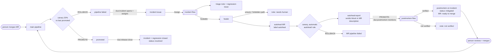
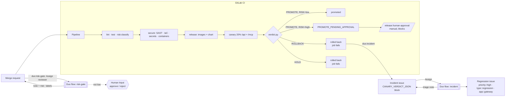

# Hackathon story: from commit to canary verdict, risk gate and incident

Issues #22 (H1), #23 (H2), #24 (H3), #28 (self-healing), #27 (H4, Duo dispatch), #33 and #34
(closing the loop in CI). ADRs:
[003 canary](adr/003-canary.md), [004 Duo flows](adr/004-duo-flows.md),
[005 self-healing](adr/005-self-healing.md), [007 Duo dispatch](adr/007-duo-dispatch.md).

**How the flows start.** GitLab gives each custom flow one trigger: **Mention**, **Assign** or
**Assign reviewer** of the flow's service account, and the flow's goal is just the iid of that
MR or issue. CI makes those assignments and mentions (`scripts/duo/dispatch.py`), so no one has
to click. The only human action in the self-healing loop is reviewing and merging the fix MR
(supervised autonomy).

## The story in one pipeline

1. **Test.** `lint` (ESLint, Prettier, typecheck) and `test` (unit, contract and integration
   tests against a real Postgres). `release:config-tests` checks the CI and flow definitions,
   `canary:unit-tests` the canary scripts. `risk:classify` labels the change `high` or `low`.
2. **Secure.** Secret Detection, SAST, IaC scanning, and Container Scanning of every pushed
   image. A scan that can't run blocks the release.
3. **Package.** Images are built with rootless BuildKit and pushed as `:<short sha>` (main) or
   `:X.Y.Z` (tags). The Helm chart is pushed as an OCI artifact, and released versions are never
   overwritten.
4. **Canary.** `canary` starts an ephemeral k3d cluster in the job, installs the stable release,
   then deploys this commit as a second gateway Deployment. A Traefik weighted route sends it
   **20 % of `/api` and `/mcp`**.
5. **Verdict.** `scripts/canary/verdict.py` sends real `tools/call woo__list_orders` traffic and
   compares error rate, p95 latency and tool success per track. The result is **PROMOTE**,
   **ROLLBACK** or **HOLD**.
6. **Risk gate.** A PROMOTE of a **high-risk** change (auth, keys, users, crypto, HTTP/MCP
   surface, SSRF guard, NetworkPolicy, values, RBAC, Secrets, CI) is not promoted. The result is
   `PROMOTE_PENDING_APPROVAL`, and the pipeline waits at the manual **`release:human-approval`**
   job. The Duo **risk-gate** flow explains why on the MR: `duo:risk-gate` adds its account as
   a reviewer on every MR pipeline.
7. **Incident.** A ROLLBACK fails the job (`RELEASE REJECTED: canary rolled back`) and so fails
   the pipeline. `duo:incident` opens the **incident** issue with the canary record inside and
   assigns it to the incident bot. The Duo **incident** flow investigates (job log, commits
   since the stable baseline), opens a **`priority::high` regression issue** and posts a triage
   note.
8. **Heal.** In the same session, the **healer** finds the suspect gateway commit, explains the
   hunk against the verdict, and opens MR **`Autoheal: <root cause> (incident #N)`** (label
   `autoheal`) with the smallest fix (a targeted hunk revert). If it is unsure, or the suspect
   touched CI, charts or secrets, it comments "needs human" instead.
9. **Verify, postmortem.** The autoheal MR's `canary` runs **automatically**: stable is the last
   promoted commit and the canary is the fix. `autoheal:report` writes the verdict into the MR
   description. On PROMOTE, `duo:postmortem` posts one note on the MR that mentions
   `@ai-canary-postmortem-gitlab-ai-hackathon` (#33). The Duo **postmortem** flow reads the
   verdict block, posts a blameless postmortem on the incident, labels it `status::mitigated`,
   and notes "verified by canary, ready to merge".
10. **Merge, release, close.** A person reviews and merges the MR: this is the only human step.
    main's `canary` checks the merged fix. On PROMOTE, `duo:release-close` (#34) closes the
    incident (note, `status::resolved`) and its open regression issue.

The canary compares this commit with the **last promoted** one (stable is built from it) and
probes a store with **24 of today's orders**. Before #28 both tracks ran the same commit on an
empty store.

### The self-healing loop

## What lives where

| Piece                                   | File                                                               |
| --------------------------------------- | ------------------------------------------------------------------ |
| Canary job, drill, risk + approval jobs | `.gitlab/ci/canary.gitlab-ci.yml`                                  |
| Canary run (cluster, deploy, verdict)   | `scripts/canary/ci.sh`, `run.sh`, `verdict.py`                     |
| Verdict record + log line               | `scripts/canary/record.jq` → `CANARY_VERDICT_JSON: {..}`           |
| Risk classifier                         | `scripts/canary/risk.py` (`--list-globs` prints rules)             |
| Approval record                         | `scripts/canary/approval.py` → `approval.json`                     |
| Flows                                   | `.gitlab/flows/incident.yaml`, `risk-gate.yaml`, `postmortem.yaml` |
| Flow dispatch (assign the bot accounts) | `.gitlab/ci/duo-dispatch.gitlab-ci.yml`, `scripts/duo/dispatch.py` |
| Dispatch CI policy test                 | `.gitlab/ci/tests/duo-dispatch.test.sh`                            |
| Flow policy + rule parity test          | `.gitlab/flows/tests/flows.test.sh`                                |
| Canary baseline + seeded orders         | `scripts/canary/ci.sh`, `seed-orders.sh`                           |
| Autoheal verdict for the postmortem     | `autoheal:report` → `autoheal_report.py` → MR description block    |
| Autoheal CI policy test                 | `.gitlab/ci/tests/autoheal-ci.test.sh`                             |
| Demo regression + offline check         | `scripts/demo/regression.sh`, `check-regression.mjs`, `README.md`  |

`release:human-approval` exists on main only when the push touches a high-risk glob (the same
globs as `risk.py`, checked by `flows.test.sh`), so low-risk main pipelines stay green. If it
does run with `RISK=low` it is a no-op (`low risk: no approval needed`), and it is skipped when
the canary failed. On MR pipelines it exists only when the diff touches a high-risk glob,
and it approves the merge.

## Register the flows (Aadi, 5 min)

Prerequisites (once): Duo Agent Platform is on for the group, and GitLab Credits are available.
Custom flows are allowed: group **Settings > GitLab Duo > Change configuration > Allow custom
flows**. You need the Maintainer role in the project.

1. **Paste the three YAMLs.** Project **AI > Flows > New flow** (or open the existing flow and
   edit it), select **Flow**, paste the file, Visibility **Private**:
   - `Canary incident` ← `.gitlab/flows/incident.yaml`
   - `Release risk gate` ← `.gitlab/flows/risk-gate.yaml`
   - `Autoheal postmortem` ← `.gitlab/flows/postmortem.yaml`
     After #27 all three changed (goal = an iid), so re-paste them even if they already exist.
2. **Enable** each flow in this project (**AI > Flows > Managed**, select the flow,
   **Enable**). GitLab creates the flow's service account and its trigger automatically. Leave
   Instructions empty: the YAML carries them. The triggers this repo expects:

   | Flow                | Service account (user id)                             | Trigger         | Who fires it                       |
   | ------------------- | ----------------------------------------------------- | --------------- | ---------------------------------- |
   | Release risk gate   | `ai-release-risk-gate-gitlab-ai-hackathon` (43587203) | Assign reviewer | `duo:risk-gate`, every MR pipeline |
   | Canary incident     | `ai-canary-incident-gitlab-ai-hackathon` (43587207)   | Assign          | `duo:incident` after a ROLLBACK    |
   | Autoheal postmortem | `ai-canary-postmortem-gitlab-ai-hackathon` (43587198) | Mention         | `duo:postmortem` after a PROMOTE   |

   If the ids differ after re-creating a flow, update `RISK_GATE_USER_ID` / `INCIDENT_USER_ID`
   in `scripts/duo/dispatch.py`.

3. **CI variable `DUO_DISPATCH_TOKEN`.** **Settings > Access tokens**: create a project access
   token, role **Developer**, scope **api**, with a short expiry. Then go to **Settings > CI/CD >
   Variables** and add it as `DUO_DISPATCH_TOKEN`: **Masked**, _not_ Protected (MR pipelines
   need it), with Expand off. Without it, the dispatch jobs print `DUO_DISPATCH_TOKEN not set;
skipping Duo dispatch` and pass. ADR 007 has the trade-offs.
4. **Project settings for the gate.** **Settings > Merge requests > Merge checks > Pipelines
   must succeed**, so a blocked high-risk MR pipeline can't be merged. Optional: create the
   labels `priority::high`, `type::regression`, `app::gateway`, `incident`, `status::ready`,
   `status::triaged`, `risk::high`, `risk::low`, `gate::infra`, `autoheal`, `status::mitigated`
   and `status::resolved` in **Manage > Labels** to pick colours. GitLab creates missing labels on
   use anyway.

## Demo script

**(a) Risk gate on an MR.**

1. Branch, change one line in `apps/gateway/src/auth/session.ts` (a comment is enough), push,
   and open an MR.
2. The MR pipeline's first job, `duo:risk-gate`, adds `ai-release-risk-gate-gitlab-ai-hackathon`
   as a reviewer. Within a minute or two the **Release risk gate** session posts a note:
   `Release risk gate: HIGH`, the matched path, and what reviewers should check. It also adds the labels `risk::high`
   and `gate::infra`. The flow's session page (from the project's AI menu) waits for **Human
   Input**. Approve it, and a second note records the decision.
3. The MR pipeline shows `risk:classify` with `RISK: high` and the matched path, and then
   **blocked** at `release:human-approval`. Run it: the log says `APPROVED by @<you>: merge of
high-risk change (...)`, and `approval.json` is attached. Only then does the pipeline pass.
4. Contrast: an MR that only touches `docs/` gets `Release risk gate: LOW` and `risk::low`, and
   has no approval job.

**(b) Rollback opens an incident (the drill).**

1. **Build > Pipelines > Run pipeline** on `main`, with the variable `CANARY_FORCE_BAD` = `1`.
   The automatic `canary` job injects a 50% error rate into the canary. (The manual
   `canary:bad-release` job on main also works: it is `allow_failure`, so the pipeline stays
   green, but `duo:incident:bad-release` still dispatches its incident.)
2. When the job finishes (it builds a whole cluster, so allow several minutes), its log ends with
   `CANARY VERDICT: ROLLBACK -> ROLLBACK, rolled-back`, the `CANARY_VERDICT_JSON: {...}` line, and
   `ERROR: RELEASE REJECTED: canary rolled back`. The job and the pipeline are **failed**.
3. `duo:incident` runs and logs `created incident #N: assigned user 43587207`. The issue
   `Incident: canary rolled back <sha> (pipeline <id>)` is labelled `incident`,
   `priority::high` and `status::ready`, marked as a drill, and has the summary, the
   stable-vs-canary table, the reasons, links, and the record block after
   `CANARY_VERDICT_JSON:`. It is assigned to `ai-canary-incident-gitlab-ai-hackathon`.
4. The **Canary incident** session starts on that assignment. It posts `## Incident triage
(Duo)` on the issue (verdict, the job's result from the CI canary record, the commits since the stable
   baseline, impact) and opens `Regression: gateway canary rejected at <sha> on main`
   (`priority::high`, `type::regression`, `app::gateway`), and the label becomes
   `status::triaged`.
5. Retrying `duo:incident` only re-assigns the same issue, and re-assigning a triaged incident
   does nothing new. A drill never reaches the healer (`force_bad` true → `done`), so there is
   no fix MR. Part (c) shows the full loop with a real regression.
6. No session? Assign the issue to `ai-canary-incident-gitlab-ai-hackathon` by hand (see
   "Honest limits": bot-made assignments may not fire triggers).

**(c) Self-healing release.** This is the full loop with a realistic regression.
[scripts/demo/README.md](../scripts/demo/README.md) has the commands.

1. `bash scripts/demo/regression.sh` creates branch `demo/faster-tool-results` with one commit:
   a 4 KB cap on pages of paginated tools. Push it, open an MR, and merge it. Its unit tests
   pass.
2. main's canary seeds today's orders and decides **ROLLBACK** with
   `canary woo__list_orders success 0.0%`. The pipeline fails. `duo:incident` opens the
   incident issue and assigns it to the incident bot. The flow posts the triage note and opens
   the regression issue.
3. The healer opens **`Autoheal: ... (incident #N)`** from `autoheal/<pipeline id>`, which
   reverts the hunk in `apps/gateway/src/core/{limits,call-tool}.ts`. Notes on both issues link
   it.
4. The MR's `canary` runs with no click and decides **PROMOTE**. `autoheal:report` (failing on
   purpose) writes `AUTOHEAL_VERDICT_JSON` into the MR description, in the "Canary verdict" block.
5. `duo:postmortem` posts one note on the MR (once per pipeline) that starts
   `@ai-canary-postmortem-gitlab-ai-hackathon !<mr iid>: the canary verified this fix`. The
   **Autoheal postmortem** session posts the postmortem on the incident, adds
   `status::mitigated`, and notes "Verified by canary ..., ready to merge" on the MR. No session?
   Post the same mention by hand.
6. Review and merge the MR (the only human step). main's canary promotes it, and
   `duo:release-close` logs `release-close: closed incident #N` and
   `release-close: closed regression #M`. Both issues are closed, and the incident is labelled
   `status::resolved`.

## Honest limits

- The flows need Duo Agent Platform, custom flows turned on, and GitLab Credits. They are
  registered by hand in the UI: the repo copy is the source, and the UI copy can drift. Re-paste
  after changes.
- Triggers are only Mention, Assign and Assign reviewer, and the goal is only an iid (ADR 007).
  CI makes the assignments with a project access token. Whether GitLab starts a flow for an
  assignment made by a bot user is **not verified yet**. If no session starts, assign or mention
  the account by hand; the flows work the same way.
- The postmortem mention is posted by the same bot user (#33). If GitLab does not start a flow
  on a bot's mention, mention the account by hand. `duo:release-close` (#34) closes the incident
  on main's PROMOTE or PROMOTE_PENDING_APPROVAL. With a high-risk fix it waits for
  `release:human-approval` (an optional `needs`), so the incident closes only after a person
  approves the release.
- The risk gate runs once per MR, when its account first becomes a reviewer. Later pushes are
  still classified in CI (`risk:classify`, `release:human-approval`).
- `DUO_DISPATCH_TOKEN` is not protected, because MR pipelines need it. Keep it Developer-only,
  `api` scope and short-lived.
- A high-risk main pipeline shows **blocked** until someone runs `release:human-approval`. That
  is the gate working. Low-risk main pipelines don't create the job. See ADR 004.
- A drill always fails its job, even when it worked. Read `DECISION` or the log.
- The CI cluster is ephemeral. "Promote" is the verdict plus the approval record, not a deploy to
  a long-lived production cluster. Stable and canary come from the same commit, with faults
  injected for the drill.
- The flow's Human Input approval is recorded on the MR, but it can't run the CI job. The
  enforcing gate is `release:human-approval`. Anyone allowed to run jobs on that ref can run it.
  Use a protected environment with approval rules (Premium) for strict separation of duties.
- Self-healing (#28) is bounded on purpose. The healer only restores lines from before one
  suspect commit, in at most 3 files, never in CI, charts, `scripts/canary/**` or secrets.
  Anything else gets "needs human". It can be wrong: the autoheal canary and the person who
  reviews and merges are the checks, and nothing merges without a person.
- `autoheal:report` always fails (allowed to fail) on autoheal MRs. Duo flows cannot read job
  logs in this project (#32), so the job writes the verdict into the MR description, and its
  failing status shows the postmortem that the pipeline reached the report (ADR 005, amendment).
  Anyone with Developer access could edit that block. The flow accepts it only for the MR's head
  pipeline, with `canary` not failing, and a person still merges. `GitLabApiGet` might read the
  verdict directly, but its tool name is unverified offline.
- The canary baseline comes from the job-token artifacts API (the latest successful default-branch
  `canary`). Without it, stable is this commit, as before, and a real regression reads as HOLD.
  Today's orders are dated at seeding, so a run that crosses midnight IST sees fewer of them.
- The flows have been checked by `flows.test.sh` (schema rules, tool names, routes). Only the
  old risk-gate prompt has run on GitLab (session 9814505, which showed goal = `"31"`); the
  rewritten flows have not run yet. Agent behaviour (exact answers, tool parameters such as
  incident type or add-labels) is resolved at run time, and the prompts include fallbacks.
