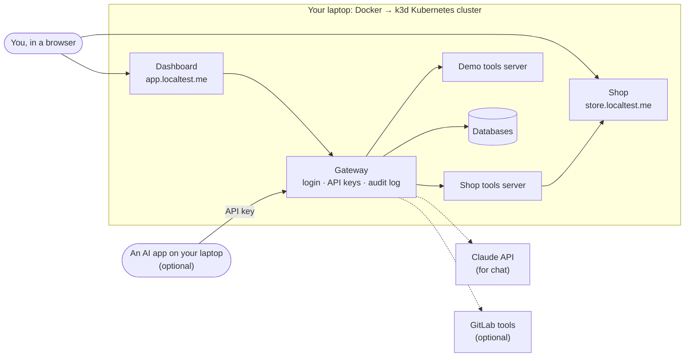
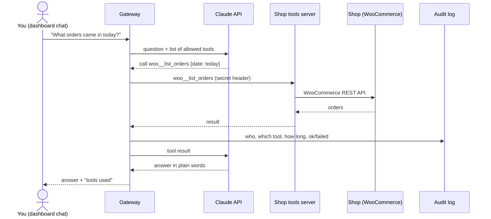

# Run it on your own computer

A plain-language guide for someone who has never seen this project. About 30 minutes the first
time, most of it waiting for downloads. The full technical README is [`../README.md`](../README.md).

## What you are running

Three things, all inside a small Kubernetes cluster on your laptop:

1. **A shop** — WordPress + WooCommerce. You can browse it and place an order.
2. **A gateway** — one secure door that lets people and AI assistants use "tools" (list orders,
   create a product, …) from several servers, with a login, API keys and a log of every call.
3. **A dashboard** — a web page to sign in, manage users and keys, see the log, and chat with an
   AI that uses those tools.



`store.localtest.me` and `app.localtest.me` are public names that always point back to your own
computer (127.0.0.1). Nothing is exposed to the internet.

## What you need

| Need                               | Notes                                                                                       |
| ---------------------------------- | ------------------------------------------------------------------------------------------- |
| macOS, Linux, or Windows with WSL2 | On Windows, run every command inside **Ubuntu (WSL2)**, not PowerShell                      |
| 8 GB RAM or more                   | Docker must be allowed **at least 6 GB** (Docker Desktop → Settings → Resources)            |
| ~15 GB free disk                   | images and databases                                                                        |
| Docker Desktop, running            | <https://www.docker.com/products/docker-desktop/>                                           |
| Ports 80 and 443 free              | if not, see [Problems](#problems)                                                           |
| Anthropic API key (optional)       | only for the chat page. <https://console.anthropic.com/> — without it everything else works |
| GitLab token (optional)            | only for the third "GitLab" tool server. Skip it; see step 5                                |

## Steps

### 1. Get the code

```sh
git clone https://gitlab.com/gitlab-ai-hackathon/transcend-october-2026/36848717/showcase.git urumi
cd urumi
```

### 2. Install the tools

```sh
scripts/dev-setup.sh
```

Installs k3d, kubectl, helm, Node.js 22, jq (Homebrew on macOS, apt on Ubuntu/WSL2) and prints
what it found. Then:

```sh
npm install
```

### 3. Create your secrets file

```sh
scripts/gen-env.sh
```

This writes `.env.local` with random passwords for everything. It is ignored by git — never commit
it or share it. If you have an Anthropic key, open `.env.local` and fill in:

```
ANTHROPIC_API_KEY=sk-ant-...
```

Leave `GITLAB_MCP_TOKEN` empty unless you have a GitLab fine-grained token with "MCP tool: Execute".

### 4. Start the cluster, build, install

```sh
scripts/cluster-up.sh      # creates the k3d cluster and loads your secrets (~1 min)
scripts/build-images.sh    # builds the 4 app images (~5 min the first time)
helm upgrade --install urumi charts/platform -n urumi \
  -f charts/platform/values-local.yaml --wait --timeout 15m   # installs everything (~5 min)
```

The install also sets up WordPress and WooCommerce automatically, so it needs internet access.

Check that everything is running (all should be `Running` or `Completed`):

```sh
kubectl -n urumi get pods
```

### 5. Add demo data and test it

Without a GitLab token:

```sh
E2E_SKIP_GITLAB=1 tests/e2e/run.sh seed
```

With a GitLab token in `.env.local`, run all the demo checks instead:

```sh
tests/e2e/run.sh all       # prints PASS seed, PASS D1 … PASS D15
```

Without the GitLab token, `run.sh all` stops at the seed (it expects all three tool servers); use
`E2E_SKIP_GITLAB=1 tests/e2e/run.sh all`, and D3 (which lists the GitLab tools) fails, as
expected. Without the Anthropic key, the chat checks D2, D4 and D12 fail.

### 6. Open it

| Open                                 | Sign in with                                                 |
| ------------------------------------ | ------------------------------------------------------------ |
| <http://store.localtest.me>          | — (the shop; try buying "Demo Tee" with Cash on delivery)    |
| <http://store.localtest.me/wp-admin> | `WP_ADMIN_USER` / `WP_ADMIN_PASSWORD` from `.env.local`      |
| <http://app.localtest.me>            | `SEED_ADMIN_EMAIL` / `SEED_ADMIN_PASSWORD` from `.env.local` |

See your logins: `grep -E '^(WP_ADMIN|SEED_ADMIN)_' .env.local`

Things to try in the dashboard: **Upstreams** (the tool servers and whether they are up),
**Members** (add users), **My keys** (make an API key for an AI app), **Chat** ("What orders came
in today?"), **Audit** (every tool call, who made it, and whether it worked). The README's
[demo walkthrough](../README.md#demo-walkthrough-manual-d1d9) has the full tour.

## Stop, restart, remove

```sh
k3d cluster stop urumi        # pause (keeps data)
k3d cluster start urumi       # resume
scripts/cluster-down.sh --yes # delete everything (add --all to also remove the image registry)
```

## Problems

| You see                                         | Do this                                                                                                                                                               |
| ----------------------------------------------- | --------------------------------------------------------------------------------------------------------------------------------------------------------------------- |
| `port 80 is in use`                             | `scripts/cluster-down.sh --yes`, then `HTTP_PORT=8080 HTTPS_PORT=8443 scripts/cluster-up.sh` and use `http://app.localtest.me:8080`. The test scripts assume port 80. |
| `helm` times out, pods `Pending` or `OOMKilled` | Give Docker more memory (≥ 6 GB), restart Docker, re-run the `helm` command                                                                                           |
| Chat says "Chat is not configured"              | Add `ANTHROPIC_API_KEY` to `.env.local`, then `scripts/secrets-apply.sh` and `kubectl -n urumi rollout restart deploy/urumi-gateway`                                  |
| `gitlab` shows **down** in Upstreams            | Expected without a GitLab token. Disable it in **Upstreams**                                                                                                          |
| `localtest.me` does not open                    | Your network blocks that DNS name. Add `127.0.0.1 store.localtest.me app.localtest.me` to your hosts file                                                             |
| Anything else                                   | `kubectl -n urumi get pods`, then `kubectl -n urumi logs <pod-name>`; more in the README's Troubleshooting                                                            |

## How the pieces fit (one level deeper)



An AI app using an API key takes the same path, minus Claude: it calls the gateway's `/mcp` address
directly, and the call is logged the same way. Tool names are always `<server>__<tool>`, so two
servers can each have a tool called `search` without clashing.

More detail: [`DESIGN.md`](DESIGN.md) (how it is built), [`THREAT_MODEL.md`](THREAT_MODEL.md) (how it
is secured), [`HACKATHON.md`](HACKATHON.md) (the self-healing release pipeline).
