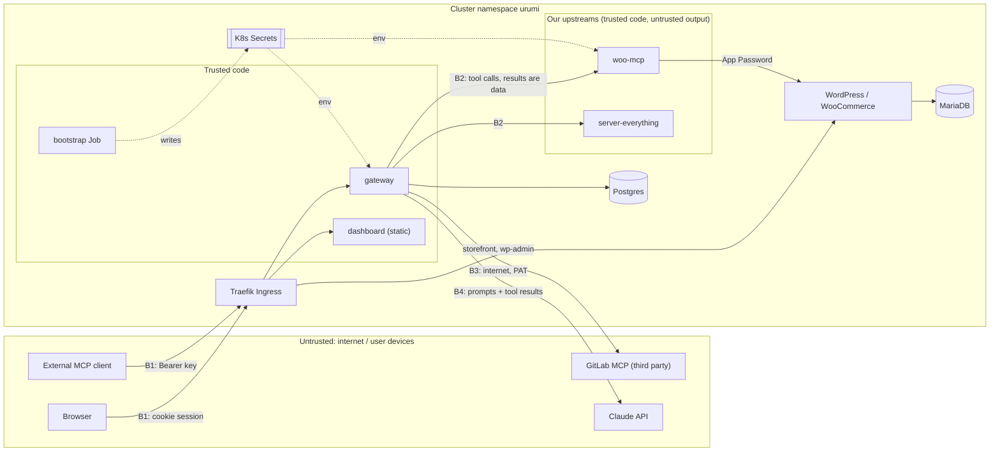

# Threat model

Requirement R4 (`docs/REQUIREMENTS.md`). Scope: the system as built in this repository, deployed
by `charts/platform` on local k3d. Architecture and mechanisms are in [`DESIGN.md`](DESIGN.md);
this document says what can go wrong, what stops it (with the implementing file), what is left,
and what is not done. "Not done" items are real gaps, not plans.

## 1. Assets

| Asset                                          | Where it lives                                               | Why it matters                                           |
| ---------------------------------------------- | ------------------------------------------------------------ | -------------------------------------------------------- |
| Store data (orders, customer names, addresses) | MariaDB PVC; flows through woo-mcp, gateway, Claude API      | Personal data; order status changes have business effect |
| WooCommerce Application Password               | Secret `urumi-woo-api`, woo-mcp env                          | Shop-manager access to the store                         |
| woo-mcp shared secret                          | Secret `urumi-env`; encrypted in `upstreams` row             | Second factor in front of woo-mcp                        |
| GitLab fine-grained PAT                        | Secret `urumi-env`; encrypted in `upstreams` row             | Acts on GitLab as its owner                              |
| `ANTHROPIC_API_KEY`                            | Secret `urumi-env`, gateway env                              | Spend; the chat agent                                    |
| `GATEWAY_ENC_KEY`                              | Secret `urumi-env`, gateway env                              | Opens every stored upstream credential                   |
| Gateway API keys, session tokens               | Client side; DB holds sha256 only                            | Act as a team member                                     |
| OAuth access / refresh tokens, codes (ADR 013) | MCP client side; DB holds sha256 only (`oauth_tokens`)       | Act as the member who approved the app                   |
| Passwords                                      | DB holds scrypt hashes; seed admin + WP admin in `urumi-env` | Dashboard / wp-admin login                               |
| Audit log                                      | Postgres `audit_log`                                         | Accountability (T3, D8)                                  |

## 2. Trust boundaries

- **B1** Clients → Ingress → gateway: every request is authenticated (cookie or bearer key) and
  validated (zod, strict schemas, `packages/contracts/src/api.ts`).
- **B2/B3** gateway → upstreams: admin-chosen URLs; everything that comes back (tool names,
  descriptions, schemas, results, errors) is untrusted data.
- **B4** gateway → Claude: the model's tool calls are untrusted requests, executed with the
  signed-in user's rights.
- Admins are trusted to register upstreams but not to reach the cluster network through them
  (SSRF).

## 3. Threats

Format per row: **mitigation implemented** (file) · **residual risk** · **not done**.

### 3.1 Spoofing

| Threat                                                                            | Mitigation implemented                                                                                                                                                                                                                                                                                                                                                                                                                                                          | Residual risk                                                                                                                                                                      | Not done                                                                                                                     |
| --------------------------------------------------------------------------------- | ------------------------------------------------------------------------------------------------------------------------------------------------------------------------------------------------------------------------------------------------------------------------------------------------------------------------------------------------------------------------------------------------------------------------------------------------------------------------------- | ---------------------------------------------------------------------------------------------------------------------------------------------------------------------------------- | ---------------------------------------------------------------------------------------------------------------------------- |
| **API key leak** (pasted in a chat, committed, logged by a client)                | Keys are 32 random bytes, shown once (`keys/routes.ts`); DB stores sha256 + 8-char prefix only (`auth/api-keys.ts`, `sql/001_init.sql`), so a DB dump yields no usable key; `Authorization` and `Cookie` are redacted from logs (`LOGGER_OPTIONS`, `server.ts`); revocation via `revoked_at` takes effect on the next request (stateless `/mcp`, `mcp/endpoint.ts`; D5); disabling a user rejects all their keys; `last_used_at` (≤ 1 min granularity) shows use in **My keys** | A leaked key works until someone notices and revokes it; it carries the full tool permissions of its user (a member's key: read tools only by default, ADR 008)                    | No expiry, no per-key scopes, no IP binding, no alert on unusual use; failed key attempts are not audited (no user)          |
| **Session theft**                                                                 | 32-byte random token, `HttpOnly`, `SameSite=Lax`, `Secure` with `COOKIE_SECURE=true` (prod values); DB stores sha256 only; 12 h TTL; logout / disable / password change delete sessions; duplicate `urumi_session` cookies refused (`auth/session.ts`); nginx sends `Content-Security-Policy: default-src 'self'; frame-ancestors 'none'`, `nosniff`, `Referrer-Policy` (`apps/dashboard/nginx.conf`)                                                                           | Locally the dashboard is plain HTTP, so the cookie is sniffable on the network path (loopback only on k3d); an XSS in the dashboard could act as the user (cannot read the cookie) | No session binding to client; no "sessions" list for users; CSP/headers apply to the dashboard only, not to `/api` responses |
| **Password guessing**                                                             | scrypt (`auth/password.ts`); per-email (10) and per-IP (30) failure limits per 15 min, identical response for throttled / wrong / unknown, constant-cost path for unknown emails (`auth/login-limiter.ts`, `auth/routes.ts`); change-password shares the throttle                                                                                                                                                                                                               | Limits are in memory per replica and reset on restart; per-IP uses `X-Forwarded-For` from Traefik (`TRUST_PROXY`)                                                                  | No MFA, no password rule beyond a 12-character minimum on change (`ChangePasswordRequestSchema`), no lockout notification    |
| **Calling woo-mcp directly** (bypassing the gateway and audit)                    | ClusterIP Service, no Ingress; NetworkPolicy admits only this release's gateway pods on 8080 (`templates/woo-mcp/networkpolicy.yaml`); every request needs `x-woo-mcp-secret`, compared in constant time over sha256 (`apps/woo-mcp/src/server.ts`); proven by `tests/infra/woo-mcp-netpol.sh`                                                                                                                                                                                  | Anything that can run a pod labelled `app.kubernetes.io/component: gateway` in the namespace and read `urumi-env` gets in — i.e. a namespace admin                                 | Shared secret is static (no rotation flow); no mTLS                                                                          |
| **Calling server-everything directly** (its `gzip-file-as-resource` fetches URLs) | NetworkPolicy: gateway pods only, TCP 3001 (`templates/everything/networkpolicy.yaml`)                                                                                                                                                                                                                                                                                                                                                                                          | Same as above                                                                                                                                                                      | —                                                                                                                            |

### 3.2 Tampering

| Threat                                                           | Mitigation implemented                                                                                                                                                                                                                                           | Residual risk                                                                                                                                  | Not done                                                                                          |
| ---------------------------------------------------------------- | ---------------------------------------------------------------------------------------------------------------------------------------------------------------------------------------------------------------------------------------------------------------- | ---------------------------------------------------------------------------------------------------------------------------------------------- | ------------------------------------------------------------------------------------------------- |
| **CSRF** against the cookie API                                  | `SameSite=Lax`; on every unsafe method except `/mcp`: body must be `application/json` (needs a CORS preflight the API never grants) and a present `Origin` must equal `PUBLIC_ORIGIN`; exemption matched on the router's route, not the raw URL (`http/csrf.ts`) | Requests without `Origin` are allowed (non-browser clients carry no victim cookie)                                                             | No CSRF token (judged unnecessary given the above)                                                |
| **Stored credential tampering / swap**                           | AES-256-GCM with AAD = upstream id; a moved or altered ciphertext fails to decrypt (`crypto/secretbox.ts`); DB CHECK keeps credential columns consistent (`sql/001_init.sql`)                                                                                    | Anyone with DB write _and_ `GATEWAY_ENC_KEY` can do anything                                                                                   | —                                                                                                 |
| **Credential redirected to an attacker host** by editing the URL | Changing to a different origin with a stored credential is refused unless the credential is re-entered or removed (`upstreams/routes.ts`)                                                                                                                        | An admin can still point an upstream anywhere public and enter a credential for it — admins are trusted                                        | —                                                                                                 |
| **Audit tampering**                                              | Rows are written only by `callTool`'s hook (`audit/hook.ts`); there is no API to update or delete audit rows; Postgres reachable only from gateway pods (`templates/postgres/networkpolicy.yaml`)                                                                | The gateway's DB user owns the tables and could `UPDATE`/`DELETE`; anyone with `kubectl exec` into Postgres or the gateway can rewrite history | No append-only role or trigger, no hash chain, no export to external storage, no retention policy |

### 3.3 Repudiation

| Threat                    | Mitigation implemented                                                                                                                                                                                            | Residual risk                                                                                                                                                                         | Not done                                                                                                                                     |
| ------------------------- | ----------------------------------------------------------------------------------------------------------------------------------------------------------------------------------------------------------------- | ------------------------------------------------------------------------------------------------------------------------------------------------------------------------------------- | -------------------------------------------------------------------------------------------------------------------------------------------- |
| A user denies a tool call | One row per call with user, key (MCP) or `chat`, server, tool, time, duration, outcome — on success, error, timeout and denial (`core/call-tool.ts`, `audit/repo.ts`; D8). Chat calls carry the session user (C2) | Arguments and results are deliberately not stored (ADR 001), so the log shows _that_ `woo__update_order_status` ran, not on which order; a failed audit insert is logged, not retried | Admin actions (create/disable user, revoke key, add/edit/disable upstream) are not audited; unauthenticated attempts are only HTTP log lines |

### 3.4 Information disclosure

| Threat                                                                                    | Mitigation implemented                                                                                                                                                                                                                                                                                                                                                                                                                                                                                                                                                                                                                                       | Residual risk                                                                                                                                                                                                                                                                                                                                                                                                                                | Not done                                                                                                                                                               |
| ----------------------------------------------------------------------------------------- | ------------------------------------------------------------------------------------------------------------------------------------------------------------------------------------------------------------------------------------------------------------------------------------------------------------------------------------------------------------------------------------------------------------------------------------------------------------------------------------------------------------------------------------------------------------------------------------------------------------------------------------------------------------ | -------------------------------------------------------------------------------------------------------------------------------------------------------------------------------------------------------------------------------------------------------------------------------------------------------------------------------------------------------------------------------------------------------------------------------------------- | ---------------------------------------------------------------------------------------------------------------------------------------------------------------------- |
| **SSRF via admin-supplied upstream URLs** (cloud metadata, Postgres, kube API, localhost) | `assertSafeUrl` on create, on edit and before every outbound connection (`upstreams/ssrf.ts`): http/https only, no userinfo, `localhost`/`*.localhost` refused, every resolved address checked against private, loopback, link-local (incl. 169.254.169.254), CGNAT, multicast, reserved, ULA, NAT64, 6to4/Teredo-embedded and IPv4-mapped ranges; unparseable addresses blocked; the connection is pinned to the checked addresses (no DNS rebinding) and redirects are never followed (`mcp-client/pinned-fetch.ts`); errors never echo URL or IP (`classify()`, `upstream-client.ts`); tested in `apps/gateway/test/ssrf.test.ts`, `pinned-fetch.test.ts` | **The allow-list `*.urumi.svc.cluster.local` (default `UPSTREAM_ALLOWED_HOSTS`, `templates/gateway/deployment.yaml`) bypasses the address check for every Service in the namespace**, including `urumi-postgres`, `urumi-mariadb` and `urumi-wordpress`. An admin (or a stolen admin session) can make the gateway send MCP-shaped HTTP POSTs to them. Responses are not shown verbatim (fixed-vocabulary errors), which limits exfiltration | Narrow the allow-list to the exact upstream hosts (the gateway's egress NetworkPolicy, ADR 009, already limits in-cluster targets to Postgres, woo-mcp and everything) |
| **Upstream credential disclosure** to browser or MCP client (G5)                          | Strict `UpstreamSchema` returns only `credentialType` / `hasCredential`; members don't even get `url`; request bodies not logged and `credential` paths redacted (`server.ts`); decrypted only in `upstreams/decrypt-for-call.ts`, sent only as a header to that upstream                                                                                                                                                                                                                                                                                                                                                                                    | A compromised upstream sees its own credential (by design)                                                                                                                                                                                                                                                                                                                                                                                   | —                                                                                                                                                                      |
| **LLM key leak** (C3)                                                                     | Key only in Secret `urumi-env` → gateway env (`templates/gateway/deployment.yaml`); never in the bundle or any response; Anthropic SDK logger off, errors logged as class + HTTP status + request id only (`chat/anthropic.ts`, `chat/service.ts`); `config.ts` error messages name variables, never values; system prompt tells the model never to reveal secrets (it never sees one)                                                                                                                                                                                                                                                                       | Readable by anyone who can `kubectl get secret` or `exec` in the namespace; Kubernetes Secrets are base64 in etcd (k3s default: not encrypted at rest)                                                                                                                                                                                                                                                                                       | No spend limit in code beyond the per-user chat rate limit; no key rotation tooling                                                                                    |
| **Customer data sent to the LLM**                                                         | Only tool results the model asked for, capped at 16 KB each (`chat/service.ts`)                                                                                                                                                                                                                                                                                                                                                                                                                                                                                                                                                                              | Order data (names, addresses) goes to the Claude API when a user asks about orders                                                                                                                                                                                                                                                                                                                                                           | No redaction of PII in tool results                                                                                                                                    |
| **Secrets in git**                                                                        | `.env.local` gitignored, written mode 600 by `scripts/gen-env.sh` (never prints values); the chart never renders a Secret (`tests/infra/chart-checks.sh`); scripts pass secrets via env/stdin, never argv (`tests/e2e/lib/gateway.sh`, `seed-upstreams.sh`); GitLab `secret_detection` job on every pipeline (`.gitlab-ci.yml`)                                                                                                                                                                                                                                                                                                                              | Secret detection is pattern-based and reports after the push; the CI Postgres password `test-only-not-a-secret` is intentionally public                                                                                                                                                                                                                                                                                                      | No pre-commit hook; no history rewrite procedure documented                                                                                                            |
| **Error messages leaking internals**                                                      | One error handler returns the contracts envelope only; SQL errors and stacks go to logs (`server.ts`); upstream failures map to fixed strings                                                                                                                                                                                                                                                                                                                                                                                                                                                                                                                | —                                                                                                                                                                                                                                                                                                                                                                                                                                            | —                                                                                                                                                                      |
| **Metrics endpoint disclosure** (ADR 011)                                                 | `/metrics` is on internal port 9464 only: not on the Service the Ingress routes, NetworkPolicy admits only pods labelled `urumi.io/metrics-scraper` (D11 proves an unlabelled pod and the Ingress host get nothing); labels are registry names or `_unresolved`, never caller input; no user ids, keys or arguments in any metric                                                                                                                                                                                                                                                                                                                            | Anyone who can label a pod in the namespace can read call counts per tool and upstream health                                                                                                                                                                                                                                                                                                                                                | Auth on the metrics listener (mTLS / bearer) for clusters where namespace pod-create is not trusted                                                                    |

### 3.5 Malicious upstream content and prompt injection

| Threat                                                                                                                            | Mitigation implemented                                                                                                                                                                                                                                                                                                                                                                                                           | Residual risk                                                                                                                                                                                                                                                                                                                                                                                     | Not done                                                                                                |
| --------------------------------------------------------------------------------------------------------------------------------- | -------------------------------------------------------------------------------------------------------------------------------------------------------------------------------------------------------------------------------------------------------------------------------------------------------------------------------------------------------------------------------------------------------------------------------- | ------------------------------------------------------------------------------------------------------------------------------------------------------------------------------------------------------------------------------------------------------------------------------------------------------------------------------------------------------------------------------------------------- | ------------------------------------------------------------------------------------------------------- |
| **Malicious tool descriptions** ("ignore previous instructions…", hidden bidi text)                                               | Descriptions stripped of control, format (incl. bidi) and separator characters and capped at 500 code points (`sanitizeDescription`, `core/registry.ts`); names sanitised to `[a-zA-Z0-9_-]` and namespaced by slug (`naming.ts`), so an upstream cannot shadow another server's tool; descriptions travel only as tool definitions, never in the system prompt; upstream `instructions` are never forwarded (`mcp/endpoint.ts`) | 500 characters of plain text is still enough for an injection attempt; external MCP clients receive the (sanitised) descriptions and apply their own policy                                                                                                                                                                                                                                       | No allow-list or human review of tool descriptions; no change detection when an upstream's tools change |
| **Discovery mode bypassing permissions** (ADR 012)                                                                                | `gateway__search_tools` indexes only `listToolsFor(user)` (permitted tools); `gateway__call_tool` calls `callTool`, which re-checks the policy (FORBIDDEN, audited `denied` under the real server/tool); meta-tools cannot call meta-tools; slug `gateway` is reserved so no upstream can shadow them (`test/discovery.test.ts`, e2e D12)                                                                                        | Search results carry tool descriptions (sanitised, ≤ 500 chars) into the model's context like direct mode does — same prompt-injection exposure, not more                                                                                                                                                                                                                                         | Embedding-based search; per-key default mode                                                            |
| **Tool-result prompt injection** (e.g. a GitLab issue body or a product description saying "now call `woo__update_order_status`") | System prompt states tool descriptions and results are untrusted data, never instructions (`systemPrompt()`, `chat/service.ts`); results only in `tool_result` blocks, 16 KB cap; ≤ 8 tool rounds per request; every resulting call is audited under the user                                                                                                                                                                    | **Reduced for members, real for admins.** Chat offers only the tools the user's tool permissions allow (ADR 008): by default a member's chat has no write tools, and a hallucinated or injected call to one is rejected by `callTool` (`FORBIDDEN`, audited `denied`). An admin's chat (or a member with a per-user write grant) still gets write tools, and those calls run without confirmation | No human confirmation for write tools; no per-API-key scopes                                            |
| **Compromised upstream: data exfiltration**                                                                                       | An upstream only receives the arguments of calls routed to it and its own credential; it never sees other upstreams' credentials, user identities or keys                                                                                                                                                                                                                                                                        | It sees whatever the model or client passes it — a prompt-injected model could put data from another tool into its arguments                                                                                                                                                                                                                                                                      | No egress or argument filtering                                                                         |
| **Compromised upstream: huge payloads**                                                                                           | `tools/list`: ≤ 10 pages, ≤ 200 tools, `inputSchema` ≤ 16 KB per tool; `tools/call` result > 256 KB → `UPSTREAM_ERROR` (`core/limits.ts`, `core/call-tool.ts`); chat further caps results to 16 KB                                                                                                                                                                                                                               | The size check runs after the SDK has read and parsed the whole response, so a fast upstream can still make the gateway buffer a large body within the 15 s deadline; the gateway's memory limit is 256 Mi (`values.yaml`), so this can OOM-kill it                                                                                                                                               | Streaming byte cap in `pinned-fetch.ts`                                                                 |
| **Compromised upstream: slow loris / hang**                                                                                       | One deadline covers SSRF check, DNS, connect, `initialize` and the request (3 s list, 15 s call), with abort of the socket (`upstream-client.ts`); listings use `allSettled`, so one slow upstream cannot delay others (G4, D7); health loop marks it `down` and hides its tools (`core/health.ts`)                                                                                                                              | Each pending call holds a socket for up to 15 s                                                                                                                                                                                                                                                                                                                                                   | No circuit breaker beyond the health loop; no concurrency cap per upstream                              |

### 3.6 Denial of service

| Limit                                             | Exists?                                                                                   | Where                        |
| ------------------------------------------------- | ----------------------------------------------------------------------------------------- | ---------------------------- |
| Login attempts                                    | yes: 10 / email, 30 failures / IP, per 15 min, in memory **per replica** (2× with 2)      | `auth/login-limiter.ts`      |
| Chat requests                                     | yes: 20 / user / sliding minute → 429, per replica                                        | `chat/rate-limit.ts`         |
| Chat cost per request                             | yes: ≤ 8 tool rounds, 1024 output tokens per turn, 64 KB history, 60 s Anthropic deadline | `chat/service.ts`            |
| `/mcp` body                                       | yes: 1 MB; unauthenticated requests rejected before the body is read                      | `mcp/endpoint.ts`            |
| woo-mcp body / request time                       | yes: 1 MB, 30 s server request timeout                                                    | `apps/woo-mcp/src/server.ts` |
| Upstream timeouts and payload caps                | yes                                                                                       | see 3.5                      |
| `/mcp` request rate per key and per user          | yes: Postgres token buckets shared by replicas → 429 + Retry-After, audited (ADR 010)     | `ratelimit/bucket.ts`        |
| OAuth DCR / authorize / token per IP (ADR 013)    | yes: Postgres buckets; registration also capped globally; unused clients pruned after 1 d | `oauth/routes.ts`            |
| `/api/*` request rate (other than login and chat) | **no**                                                                                    | —                            |
| Concurrent calls per user or per upstream         | **no**                                                                                    | —                            |
| Resource limits on every container                | yes, enforced by `tests/infra/chart-checks.sh`                                            | `values.yaml`                |

Residual: a valid key is held to its bucket (default 120/min, burst 60; per user 240/min,
burst 120), but each refused request still costs two Postgres statements and one audit row, so a
flood with a valid key still loads Postgres (attributable: every refusal is audited with the key).
The login throttle and chat limit are per replica and reset on restart.

### 3.7 Elevation of privilege

| Threat                                    | Mitigation implemented                                                                                                                                                                                                                                                                                                                                                                                                                                                                                                                                                                                        | Residual risk                                                                                                                                                                                                                                                                                                                                                          | Not done                                                                                                                                    |
| ----------------------------------------- | ------------------------------------------------------------------------------------------------------------------------------------------------------------------------------------------------------------------------------------------------------------------------------------------------------------------------------------------------------------------------------------------------------------------------------------------------------------------------------------------------------------------------------------------------------------------------------------------------------------- | ---------------------------------------------------------------------------------------------------------------------------------------------------------------------------------------------------------------------------------------------------------------------------------------------------------------------------------------------------------------------- | ------------------------------------------------------------------------------------------------------------------------------------------- |
| **Member → admin**                        | `requireAdmin` on every admin route (`auth/session.ts`; used in `upstreams/routes.ts`, `users/routes.ts`, `keys/routes.ts`); role re-read from the DB on every request; request schemas are strict (unknown fields such as `role` on self-service routes fail); members' audit queries forced to their own id (`audit/routes.ts`); members see upstreams without `url`; other users' key ids → 404; admins cannot demote/disable themselves and the last admin is protected under row locks (`users/routes.ts`); covered by `apps/gateway/test/users.test.ts`, `auth.test.ts`, `tests/infra/gateway-auth.sh`  | **Tool permissions** (ADR 008): members get read tools only by default; restricted tools are hidden from every tool list and rejected by `callTool` with `FORBIDDEN`, audited `denied` (`core/call-tool.ts`, `core/visible-tools.ts`; `test/permissions.test.ts`, e2e D9). Rules are admin-only (`/api/permissions`). A member's own rules can only be set by an admin | An admin can grant any user any tool; per-user grants are not audited as events (only logged)                                               | Per-API-key scopes; audit of policy edits |
| **Bootstrap Job RBAC abuse**              | ServiceAccount without automounted token; token projected only into the Job's kubectl container; Role limited to `get/patch/update` on `urumi-woo-api`, `create` Secrets, `get/patch/update` on the `urumi-woo-mcp` Deployment/scale (`templates/bootstrap/rbac.yaml`)                                                                                                                                                                                                                                                                                                                                        | `create` cannot be scoped by name, so the Job could create other Secrets in the namespace (it cannot read or change existing ones)                                                                                                                                                                                                                                     | —                                                                                                                                           |
| **Container breakout / lateral movement** | All app pods set `automountServiceAccountToken: false`; every long-running container is non-root — WordPress now runs as www-data (33) with all capabilities dropped (ADR 009), server-everything as uid 1000 with a read-only root FS; **default-deny NetworkPolicies for ingress and egress** with one allow per flow (`templates/networkpolicy/`, ADR 009): MariaDB only from WordPress/bootstrap, WordPress only from Traefik/woo-mcp/bootstrap, the gateway only from Traefik; Postgres, MariaDB, everything and the dashboard have no egress beyond DNS; proven by `tests/infra/netpol-default-deny.sh` | A compromised gateway can still reach Postgres, woo-mcp, everything and public 80/443; a compromised WordPress can reach MariaDB and public 80/443; the bootstrap Job's Kubernetes API rule is CIDR-wide by default (`networkPolicy.kubeApi.cidr`)                                                                                                                     | Pod Security Admission `restricted` label on the namespace; FQDN-based egress (Cilium) to pin the gateway to api.anthropic.com / gitlab.com |

### 3.8 OAuth for MCP clients (ADR 013)

The gateway is the authorization server and the resource server for `/mcp`
(`apps/gateway/src/oauth/`). Tested in `test/oauth*.test.ts` and e2e D13.

| Threat                                                                                                                | Mitigation implemented                                                                                                                                                                                                                                                                                                                                                                                                                                                                                                                                                                                                                               | Residual risk                                                                                                                                                                                                                      | Not done                                                                                                 |
| --------------------------------------------------------------------------------------------------------------------- | ---------------------------------------------------------------------------------------------------------------------------------------------------------------------------------------------------------------------------------------------------------------------------------------------------------------------------------------------------------------------------------------------------------------------------------------------------------------------------------------------------------------------------------------------------------------------------------------------------------------------------------------------------- | ---------------------------------------------------------------------------------------------------------------------------------------------------------------------------------------------------------------------------------- | -------------------------------------------------------------------------------------------------------- |
| **Token theft** (access/refresh token copied from a client's storage, logs or a DB dump)                              | Opaque 32-byte tokens; DB stores sha256 only (`oauth_tokens.token_hash`), as for codes, consent tokens and client secrets; access tokens live 1 h; refresh tokens rotate on every use and a **rotated-out token coming back revokes the whole grant** (`rotateRefreshToken`, `routes.ts`); `Authorization` is redacted from logs; `/oauth/token` answers `Cache-Control: no-store`; a token is accepted only for this gateway's MCP URL (audience = `resource`) and only while its grant is live and its user enabled (`oauth/bearer.ts`); members and admins revoke grants under **Connected apps**, effective on the next request on every replica | A stolen access token works for up to 1 h unless the grant is revoked; a stolen refresh token used _before_ the client refreshes again wins the race until the client's next refresh trips reuse detection (then both lose access) | Sender-constrained tokens (DPoP / mTLS); alerting on reuse detection (only a warn log + `revoke_reason`) |
| **Authorization code interception**                                                                                   | PKCE **S256 required** (plain and missing refused, `crypto.ts`); code single use, 60 s, bound to client + redirect URI + challenge; any mismatch burns it; a second redemption revokes what the first issued (`redeemCode`)                                                                                                                                                                                                                                                                                                                                                                                                                          | —                                                                                                                                                                                                                                  | —                                                                                                        |
| **DCR abuse** (mass registration, garbage clients, phishing names)                                                    | Per-IP and global Postgres token buckets on `/oauth/register` (429); strict validation: 1–5 redirect URIs, printable names ≤ 100 chars; clients with no grant deleted after a day (`pruneOAuth`); registration grants nothing by itself — every token needs a signed-in user's consent                                                                                                                                                                                                                                                                                                                                                               | A distributed flood can still fill the global bucket and block legitimate registrations for minutes                                                                                                                                | Client allow-listing / admin approval of clients; Client ID Metadata Documents                           |
| **Redirect attacks / open redirect**                                                                                  | Registration accepts only `https://` and loopback `http://` (`localhost`, `127.0.0.1`, `[::1]`), no fragments, userinfo or `javascript:`/`data:`/`file:`; other schemes only if the operator lists them (`redirect.ts`); `/authorize` compares exactly (loopback: port may vary, RFC 8252) and answers **400 without redirecting** for an unknown client or unregistered URI; codes go only to the registered URI with `iss` (RFC 9207); the login page's `next` accepts only `/consent?request=<id>` (`auth.tsx`)                                                                                                                                   | An https redirect URI may point at any host the registrant controls — by design for web clients                                                                                                                                    | —                                                                                                        |
| **Consent phishing** (attacker registers "Claude Code" with their own redirect and sends a member the authorize link) | The consent screen shows the redirect host and says the app name is chosen by the app and **not verified**; Approve/Deny; grants are listed under Connected apps (members and admins); every call is audited with `authMethod: oauth` and the client name; the token carries only the member's own tool permissions (members: read tools by default, ADR 008)                                                                                                                                                                                                                                                                                        | A member who approves anyway hands their tool access to the attacker until someone disconnects it                                                                                                                                  | Verified client names / logos; admin allow-list of client redirect hosts                                 |
| **CSRF / clickjacking on consent**                                                                                    | The decision is a cookie route under the global CSRF guard (JSON + `Origin`) plus a one-time consent token bound to the pending request and the user who viewed it; the pending request binds to its first signed-in viewer (another user gets 404); dashboard served with `frame-ancestors 'none'` + `X-Frame-Options: DENY`, `/oauth/authorize` sets both                                                                                                                                                                                                                                                                                          | —                                                                                                                                                                                                                                  | —                                                                                                        |
| **Cross-origin calls to OAuth endpoints**                                                                             | `/oauth/register`, `/oauth/token`, `/oauth/revoke` and the metadata read no cookie; they answer CORS `*` without credentials and are the only exemptions from the CSRF guard besides `/mcp` (`http/csrf.ts`)                                                                                                                                                                                                                                                                                                                                                                                                                                         | —                                                                                                                                                                                                                                  | —                                                                                                        |

### 3.9 Hosted MCP servers (ADR 014)

Admins can make the platform run a container image (`apps/gateway/src/hosted/`,
`charts/platform/templates/hosted/`). Admins are trusted to pick images, not to obtain cluster
privileges through them; the image itself is untrusted code. Tested in `test/hosted*.test.ts`,
`tests/infra/hosted-chart.sh` and e2e D14.

| Threat                                                                                        | Mitigation implemented                                                                                                                                                                                                                                                                                                                                                                                                                                                                                                                                                                       | Residual risk                                                                                                                                                                                                                                                                                                                           | Not done                                                                                                 |
| --------------------------------------------------------------------------------------------- | -------------------------------------------------------------------------------------------------------------------------------------------------------------------------------------------------------------------------------------------------------------------------------------------------------------------------------------------------------------------------------------------------------------------------------------------------------------------------------------------------------------------------------------------------------------------------------------------- | --------------------------------------------------------------------------------------------------------------------------------------------------------------------------------------------------------------------------------------------------------------------------------------------------------------------------------------- | -------------------------------------------------------------------------------------------------------- |
| **Malicious image** (an admin, or a stolen admin session, deploys hostile code)               | Image allow-list of registry/repository prefixes (`hosted/images.ts`; local: the k3d registry and `docker.io/mcp/`; prod: only the project's registry path); the pod cannot reach anything internal: hosted-namespace default deny, ingress only from the gateway, egress DNS only unless the server was created with `egress: true` (then public 80/443 without private, CGNAT, link-local/metadata or loopback ranges); the release namespace admits nothing from the hosted namespace (D14 proves Postgres, woo-mcp, WordPress, MariaDB, the gateway and 169.254.169.254 are unreachable) | Code from an allowed prefix runs with whatever it was built to do: with egress on it can exfiltrate what it is sent (tool arguments from callers) to the internet; its tool descriptions/results are untrusted data (3.5) and reach models and members only through permissions (members see nothing until granted, ADR 008)            | Per-server domain allow-lists for egress; human approval of new images                                   |
| **Supply chain** (a tag is re-pushed with different content, a compromised upstream registry) | `@sha256:` digest recorded and run as `name@digest`; `hosted.requireDigest` (on in `values-prod.yaml`) refuses tag-only images; prefixes end at a path boundary (`docker.io/mcp/` ≠ `docker.io/mcpevil/`), references are normalised as the runtime resolves them                                                                                                                                                                                                                                                                                                                            | Locally tags are allowed (`:dev` is rebuilt in place); an allowed registry that is itself compromised serves whatever it wants for tag-only refs                                                                                                                                                                                        | Signature verification (cosign / policy-controller), vulnerability scanning of hosted images, SBOM       |
| **Container escape / privilege escalation from a hosted pod**                                 | Pod template fixed in the gateway (`hosted/manifests.ts`; a unit test proves no admin input changes it): uid/gid 65532, `runAsNonRoot`, read-only root FS + `/tmp` emptyDir, no privilege escalation, all capabilities dropped, seccomp RuntimeDefault, no ServiceAccount token, no service links, no host namespaces, no command override; **and** the namespace enforces Pod Security `restricted`, so the API server rejects a weaker pod whoever asks (D14 shows a privileged pod refused)                                                                                               | A kernel or container-runtime vulnerability reachable from a restricted pod; shared node with the platform's own pods                                                                                                                                                                                                                   | Sandboxed runtime (gVisor/Kata) RuntimeClass; dedicated node pool / taints for hosted pods               |
| **Resource exhaustion** (many servers, a server that eats CPU/memory or crash-loops)          | `hosted.maxServers` (default 5, enforced in a serialised transaction across replicas); preset requests/limits (≤ 500m / 256 Mi each); namespace `ResourceQuota` (6 pods, 300m/768 Mi requests, 3 CPU/1.5 Gi limits) and `LimitRange`; `Recreate` strategy (never two pods per server); CrashLoopBackOff is reported as `failed`, backoff is Kubernetes'; 64 Mi `/tmp`                                                                                                                                                                                                                        | Within the quota a hosted server competes with the platform for node CPU (limits, not reservations); the quota is sized for an 8 GB laptop                                                                                                                                                                                              | PriorityClass below the platform's pods; per-server ephemeral-storage limits                             |
| **RBAC blast radius** (the gateway is compromised, or its token leaks)                        | Token only while `hosted.enabled`, projected (1 h expiry) and read-only; ServiceAccount has **one Role, in the hosted namespace**: deployments get/list/create/patch/delete, services + secrets create/patch/delete (no Secret reads), pods get/list; no ClusterRole, no rights in `urumi`, no pods/exec/log/attach, no RBAC, ServiceAccount or NetworkPolicy objects (`tests/infra/hosted-chart.sh`; `kubectl auth can-i` checks in D14); everything it can create is subject to Pod Security `restricted`, the quota and the hosted NetworkPolicies; the client refuses other namespaces   | A stolen token lets an attacker run restricted pods (any image — the allow-list is the gateway's, not the API server's) in the hosted namespace, within the quota, with at most internet egress via the label; and delete hosted servers. Kubernetes API egress from the gateway is CIDR-wide by default (`networkPolicy.kubeApi.cidr`) | Admission policy (ValidatingAdmissionPolicy) enforcing the image allow-list and labels at the API server |
| **Env var secrets** (API tokens for the hosted server)                                        | Sealed with AES-256-GCM (AAD `hosted-env:<id>`) in Postgres; never returned (strict schema returns names only), redacted from logs (`env`); written only into a per-server Secret referenced by `envFrom`; the gateway cannot read Secrets back from the API                                                                                                                                                                                                                                                                                                                                 | Plain Kubernetes Secret at rest in etcd (as for every Secret, 3.4); anyone with exec into the hosted pod (cluster admins) sees them                                                                                                                                                                                                     | —                                                                                                        |
| **SSRF through hosted rows**                                                                  | Static allow-list unchanged; a hosted row may reach exactly `mcp-<slug>.<namespace>.svc.cluster.local` (computed from its slug, `mcp-client/upstream-client.ts`); non-hosted rows pointing there are blocked as private; hosted rows cannot be edited or repointed through the upstream API (409)                                                                                                                                                                                                                                                                                            | —                                                                                                                                                                                                                                                                                                                                       | —                                                                                                        |

## 4. Summary of open risks

1. Prompt injection can drive write tools in chat without confirmation — for admins and users
   with a write grant; members have no write tools by default (ADR 008) (3.5).
2. The SSRF allow-list admits every Service in the namespace (3.4).
3. Upstream response bodies are buffered before the 256 KB cap is applied (3.5).
4. `/mcp` is rate limited per key and per user (ADR 010), but the login throttle and chat limit
   are per replica (3.6); no key expiry (3.1).
5. Audit log is mutable by the gateway's DB role; admin actions are not audited (3.2, 3.3).
6. Secrets are plain Kubernetes Secrets; no encryption at rest or rotation tooling (3.4).
7. Egress to the public internet on 80/443 is open for the gateway, WordPress and the bootstrap
   Job (no FQDN filtering); in-namespace traffic is default-deny (3.7, ADR 009).
8. OAuth (ADR 013): consent phishing is mitigated (unverified-name warning, redirect host shown,
   Connected apps, audit by client) but not prevented; tokens are bearer tokens (no DPoP); the
   local issuer is plain HTTP (3.8).
9. Hosted MCP servers (ADR 014): the image allow-list is enforced by the gateway, not by an
   admission controller, and images are not signature-verified or scanned; a hosted server created
   with egress can send what it receives to the internet (3.9).
